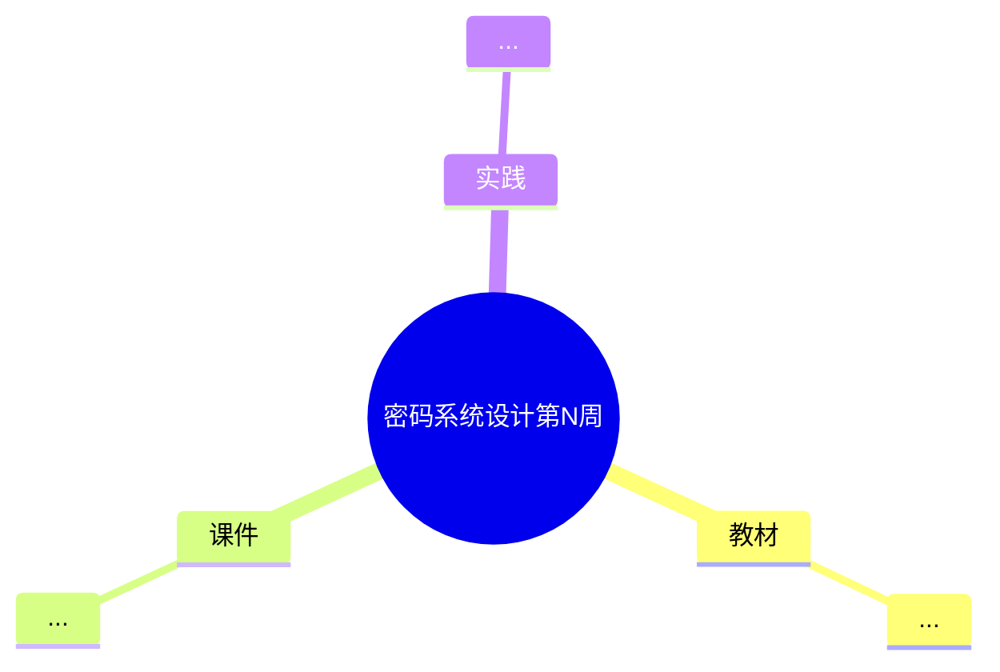

# 报告骨架

以 `handmade/homework1.md`（第二周手工版）为唯一基准。标题、顺序、分值标注**不可增删改**。

## 完整骨架

```markdown
# 密码系统设计

## 第N周预习报告

### 学习内容

- [书名](链接) 第N章
  - 第N章重点：X.X，X.X，特别 X.X.X（这一节的要点）
- [课程 mindmap](链接)
- <老师本周的额外要求，没有就删掉这一行>

---

### AI 对学习内容的总结（1分）

#### 要求

<照抄老师的要求原文>

#### 总结

> **1. 加粗小标题：**
> 内容……
>
> **2. 加粗小标题：**
> 内容……

---

### 对 AI 总结的反思与补充（2分）

#### 要求

- AI总结的问题
- 自己的补充

#### 反思与补充

- **AI 总结的不足**：<一句话点明最大的问题>
- **我的补充**：
  - <补充 1>
  - <补充 2>

---

### 学习实践过程遇到的问题与解决方式（AI 驱动，优先使用 AI 工具解决问题）（2分）

#### 问题 1：<一句话说清是什么问题>

- **出现环境**：
- **解决过程**：
  1. <第一步做了什么>
  2. <遇到的报错，用反引号包裹原文>
  3. <怎么定位的>
  4. <最终怎么解决的>
- **经验总结**：

#### 问题 2：<同上>

<同上>

---

## 参考资料

### AI 工具（你使用的 AI 工具及其链接）

- [工具名](https://...)

### 图书

- [《书名》](链接)

### 网站

- [官网名](https://...)

---

### 学习思维导图（2分）

#### 要求

Mermaid 代码与截图，或提交思维导图链接。

#### 思维导图


```

## 各节必备要素

| 章节 | 分值 | 必备要素 |
| --- | --- | --- |
| 学习内容 | — | 书名（markdown 链接）+ 章节号 + 重点小节号原样保留 + 每节讲什么 |
| AI 对学习内容的总结 | 1 | 引用块；2-3 段；每段有 `**加粗小标题：**`；只写"书里讲了什么"，不写评价 |
| 对 AI 总结的反思与补充 | 2 | 「不足」+「我的补充」两级；我的补充必须是用户观点；至少一条教材里没有 |
| 实践问题与解决 | 2 | 2 个问题；每个含出现环境 / 解决过程 / 经验总结；解决过程有失败尝试 |
| 参考资料 | — | AI 工具 / 图书 / 网站 三类齐全，链接真实访问过 |
| 学习思维导图 | 2 | `mindmap`；根节点 `((密码系统设计第N周))`；教材 / 课件 / 实践 三大分支 |

## 可选小节

`#### 实践过程（简要记录）` —— 手工版第一周用过（记录装环境步骤），第二周没用。
只在用户确实动手做了安装 / 配置类工作时加，纯读书不要加。

## 长度参考

手工版第二周共 121 行。**不要为了凑长度注水，也不要压到 80 行以下**——
五个章节齐全、思维导图完整的情况下，正文（不含导图代码）约 90-110 行是合理区间。
