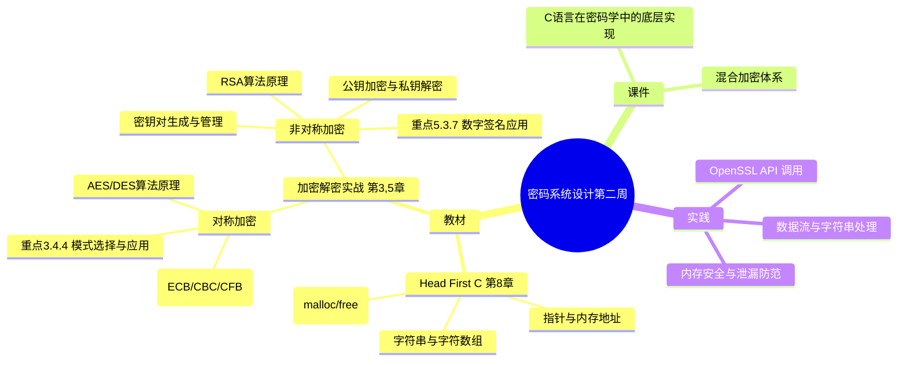

# 密码系统设计

## 第二周预习报告

### 学习内容

- [Head First C 嗨翻 C 语言](https://www.ituring.com.cn/book/1004) 第8章
- [《Windows C/C++加密解密实战》](https://weread.qq.com/web/bookDetail/a0332190813ab78fag011422?wfrom=bookDetailH5)第3,5章
  - 第三章重点：3.4，3.5，特别 3.4.4（对称加密算法原理与实现）
  - 第五章重点：5.3.7（非对称加密算法应用）
- [课程 mindmap](https://www.processon.com/mindmap/66bcf83cce68f62ecf3f63fc?from=pwa)
- 报告内容参考第一周

---

### AI 对学习内容的总结（1分）

#### 要求

让 AI（Kimi，元宝等）阅读学习内容并进行总结。

#### 总结

> **1. C 语言基础（《Head First C》第8章）：** 本章重点介绍了字符串与指针、数组的关系。C 语言中字符串本质上是字符数组，以 `\0` 结尾。指针用于直接操作内存地址，理解指针、数组名和字符串字面量之间的转换关系是编写高效 C 语言代码的关键。同时，本章也提到了`malloc()`动态内存分配与`free()`释放内存，这是处理加解密数据时避免内存泄漏的基础。
>
> **2. 对称加密（《Windows C/C++加密解密实战》第3章）：** 第3章详细讲解了对称加密算法（如 DES、AES）。重点 3.4.4 涉及分组密码的工作模式（如 ECB、CBC、CFB、OFB），这些模式决定了如何安全地将明文块转换为密文块。第五章重点 5.3.7 则关注非对称加密（如 RSA），包括密钥对的生成、公钥加密与私钥解密、以及数字签名的基本原理。两者通常结合使用，形成混合加密系统。

---

### 对 AI 总结的反思与补充（2分）

#### 要求

- AI总结的问题
- 自己的补充

#### 反思与补充

- **AI 总结的不足**：AI 总结偏向概念罗列，缺少了 C 语言指针操作与加解密数据流结合的实战细节，也忽略了 ECB 模式在实际应用中的安全缺陷（如相同明文块生成相同密文块，容易暴露数据模式）。
- **我的补充**：
  - 在 C 语言中处理加密数据时，字符串的 `\0` 截断问题非常关键。加解密往往处理的是二进制字节流，不能直接用 `strcpy` 等字符串函数，必须使用 `memcpy` 或带长度参数的函数，这点在《Head First C》中并未深入加密场景。
  - 对于非对称加密，RSA 算法涉及大数运算，直接使用 OpenSSL 的 API（如 `RSA_generate_key_ex`、`EVP_PKEY_encrypt`）比手动实现大数库要安全得多。学习重点应放在理解其背后的数学原理与 OpenSSL 的函数调用逻辑上。

---

### 学习实践过程遇到的问题与解决方式（AI 驱动，优先使用 AI 工具解决问题）（2分）

#### 问题 1：Windows 环境下 Visual Studio 工具链配置错误，导致无法生成 OpenSSL 的 Makefile

- **出现环境**：Windows 10 + VS Code。
- **解决过程**：
  1. 尝试在 Windows 下编译 OpenSSL 3.5.8，遇到 `'cl' 不是内部或外部命令` 报错，发现缺少 C++ 编译器环境。
  2. 在 AI 建议下安装 Visual Studio Build Tools，但配置路径时出现 `vcvars64.bat` 找不到的报错，发现是路径不匹配（缺少 `s` 和路径错误）。
  3. 尝试使用 `nmake test` 编译时，又遇到 `LNK1168: 无法打开 libssl-3-x64.dll 进行写入` 的权限拒绝错误。
  4. 排查发现是 Windows 环境下盘符权限混乱、D盘出现大量 `Microsoft.*` 和 `system.*` 缓存文件夹，导致文件权限异常。
- **经验总结**：在 Windows 下进行 C/C++ 密码学开发，环境配置极其繁琐，容易遇到不可预知的权限与路径问题。最终决定迁移到 Linux 环境（Ubuntu）进行实践，在 Linux 下使用 `./config`、`make` 直接编译，一次通过，避免了大量 Windows 特有的环境问题。

#### 问题 2：OpenSSL 和 GmSSL 安装后命令不可用

- **出现环境**：Linux（Ubuntu 22.04 / WSL）。
- **解决过程**：
  1. 按照课程脚本成功编译并 `make install` 了 OpenSSL 3.3.2 和 GmSSL 3.1.1。
  2. 运行 `openssl version` 或 `gmssl version` 时报 `command not found`。
  3. 检查发现脚本虽然将 `export PATH` 写入 `~/.bashrc`，但当前 Shell 会话未重新加载。
  4. 执行 `source ~/.bashrc` 后，再次输入命令，成功显示版本信息。对于 GmSSL，还需要同步检查 `LD_LIBRARY_PATH` 环境变量是否包含 `lib` 目录。
- **经验总结**：修改 `.bashrc` 后必须使用 `source` 或重启终端，环境变量才能生效。使用 AI 排查时，通过 `echo $PATH` 能快速定位环境变量问题。

---

## 参考资料

### AI 工具（你使用的 AI 工具及其链接）

- [Deepseek](https://chat.deepseek.com/)

### 图书

- [《Windows C/C++加密解密实战》](https://weread.qq.com/web/bookDetail/a0332190813ab78fag011422?wfrom=bookDetailH5)
- [Head First C 嗨翻 C 语言](https://www.ituring.com.cn/book/1004)

### 网站

- [GmSSL 官网](https://gmssl.org/)
- [OpenSSL 官网](https://openssl-library.org/)

---

### 学习思维导图（2分）

#### 要求

Mermaid 代码与截图，或提交思维导图链接。

#### 思维导图

