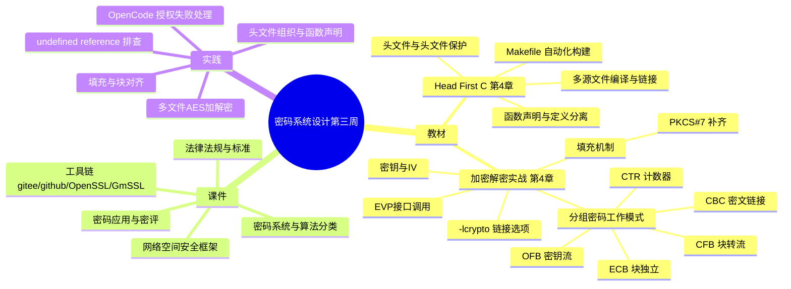

# 密码系统设计

## 第三周预习报告

### 学习内容

- [Head First C 嗨翻 C 语言](https://www.ituring.com.cn/book/1004) 第4章
  - 第四章重点：多源文件的编译与链接、头文件与头文件保护、函数声明与定义分离、Makefile 自动化构建
- [《Windows C/C++加密解密实战》](https://weread.qq.com/web/bookDetail/a0332190813ab78fag011422?wfrom=bookDetailH5)第4章
  - 第四章重点：4.2，4.3，4.5（分组密码工作模式、填充机制、OpenSSL EVP 接口调用）
- [课程 mindmap](https://www.processon.com/mindmap/66bcf83cce68f62ecf3f63fc?from=pwa)

---

### AI 对学习内容的总结（1分）

#### 要求

让 AI（Kimi，元宝等）阅读学习内容并进行总结。

#### 总结

> **1. C 语言多文件工程（《Head First C》第4章）：** 本章讲解了如何把一个程序拆成多个源文件分别编译，再由链接器合并成可执行文件。核心是头文件的使用：用头文件保护宏（`#ifndef`/`#define`/`#endif`）避免重复包含，用函数声明与定义分离的方式，让调用方只看到接口而不必关心实现细节。章末的 Makefile 则把编译、链接、清理这些命令固化下来，实现一键构建与模块化管理。
>
> **2. 分组密码工作模式与填充机制（《Windows C/C++加密解密实战》第4章）：** 重点 4.2 介绍 ECB、CBC、CFB、OFB、CTR 五种工作模式，说明同一把密钥下明文块是如何被串成密文链的，它们决定了相同明文块是否会产生相同密文；重点 4.3 讲填充机制，因为分组密码要求明文长度为块大小的整数倍，不足时需要按 PKCS#7 等标准补齐；重点 4.5 讲 OpenSSL 的 EVP 接口调用流程，包括 `EVP_EncryptInit_ex`、`EVP_EncryptUpdate`、`EVP_EncryptFinal_ex` 三个函数的分工，以及编译时必须链接 `-lcrypto` 库的要求。

---

### 对 AI 总结的反思与补充（2分）

#### 要求

- AI总结的问题
- 自己的补充

#### 反思与补充

- **AI 总结的不足**：AI 总结把工作模式和填充机制都停在了"流程是什么"，没有说明 CBC 模式下 IV 重复使用会泄露明文前缀的相等关系；也没有把《Head First C》第 4 章讲的链接原理和 `-lcrypto` 的报错联系起来，两部分内容在它眼里是互不相干的。
- **我的补充**：
  - CBC 模式的安全性依赖 IV 每次随机且不可预测。密钥不泄露的情况下，如果 IV 固定或重复，攻击者仍能判断出两段密文里哪些明文块彼此相同，等于把明文的相等关系直接暴露出去；这也是 CTR、OFB 只要求 IV 唯一、而不像 CBC 那样要求 IV 保密的原因。
  - `-lcrypto` 那个 `undefined reference to 'EVP_EncryptInit_ex'` 报错，其实正是《Head First C》第 4 章讲的链接问题：函数只有声明、本地对象文件里没有实现，符号要由外部库提供，而这个符号属于 `libcrypto` 而不属于 `libssl`，漏写链接选项就找不到。教材把"C 语言链接原理"和"OpenSSL 库调用"分开讲，但真写多文件 AES 程序时这两块是撞在一起的。

---

### 学习实践过程遇到的问题与解决方式（AI 驱动，优先使用 AI 工具解决问题）（2分）

#### 问题 1：多文件 AES 程序链接 `EVP_EncryptInit_ex` 失败，且明文长度不是整块时输出异常

- **出现环境**：Windows 10 + MinGW (GCC) + OpenSSL 3.x。
- **解决过程**：
  1. 把 AES 加解密拆成 `aes.h`、`aes.c`、`main.c` 三个文件，用 `gcc -c` 分别编译都能通过，但链接成 exe 时报 `undefined reference to 'EVP_EncryptInit_ex'`。
  2. 意识到符号不在本地对象文件里、需要外部库提供，补上 `-lcrypto` 链接选项后通过。
  3. 换 7 字节明文测试时又发现输出长度不对，查资料后发现 `EVP_CIPHER_CTX_set_padding()` 默认是开启的 PKCS#7 填充，会补 n 个值为 n 的字节凑成块大小整数倍。
  4. 用 `EVP_CIPHER_CTX_set_padding()` 处理时发现另一层行为变化：一旦关闭填充，`EVP_EncryptFinal_ex()` 就不再处理尾部不足一整块的数据，明文长度必须自己保证是对齐的。
- **经验总结**：多源文件工程里编译通过不代表链接能过，符号到底来自哪个库要在写 Makefile 时就明确；而 EVP 的填充开关会改变 `EVP_EncryptFinal_ex` 的行为契约，关填充之前必须先确认明文长度。

#### 问题 2：OpenCode 执行依赖安装命令时授权失败，脚本无法运行

- **出现环境**：Windows 10 + OpenCode CLI。
- **解决过程**：
  1. 计划用 OpenCode 智能体自动完成环境安装与导出脚本，但执行到需要授权的命令时中断，提示 `Device approval failed`，后续依赖脚本也被拦截。
  2. 排查发现不是命令本身有问题，而是 OpenCode 的设备授权流程没有走通。
  3. 重新走了一遍设备码/浏览器授权登录流程，授权状态恢复正常。
  4. 授权恢复后再执行同样的依赖安装与脚本命令，正常通过。
- **经验总结**：AI 智能体有明确的权限边界，授权类报错应先确认授权状态，而不是反复改命令。把 AI 用在方案设计、报错分析和代码编写上更可靠，直接让它代办系统操作收益有限。

---

## 参考资料

### AI 工具（你使用的 AI 工具及其链接）

- [OpenCode](https://opencode.ai)
- [Deepseek](https://chat.deepseek.com/)

### 图书

- [《Windows C/C++加密解密实战》](https://weread.qq.com/web/bookDetail/a0332190813ab78fag011422?wfrom=bookDetailH5)
- [Head First C 嗨翻 C 语言](https://www.ituring.com.cn/book/1004)

### 网站

- [OpenSSL 官网](https://openssl-library.org/)
- [EVP_EncryptInit 官方手册](https://docs.openssl.org/3.0/man3/EVP_EncryptInit)

---

### 学习思维导图（2分）

#### 要求

Mermaid 代码与截图，或提交思维导图链接。

#### 思维导图

