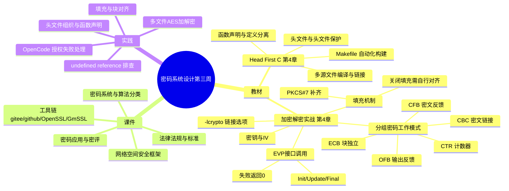

# 密码系统设计

## 第三周预习报告

### 学习内容

- [Head First C 嗨翻 C 语言](https://www.ituring.com.cn/book/1004) 第4章
  - 第四章重点：多源文件的编译与链接、头文件与头文件保护、函数声明与定义分离、Makefile 自动化构建
- [《Windows C/C++加密解密实战》](https://weread.qq.com/web/bookDetail/a0332190813ab78fag011422?wfrom=bookDetailH5)第4章
  - 第四章重点：4.2，4.3，4.5（分组密码工作模式、填充机制、OpenSSL EVP 接口调用）
- [课程 mindmap](https://www.processon.com/mindmap/66bcf83cce68f62ecf3f63fc?from=pwa)

---

### AI 对学习内容的总结（1分）

#### 要求

让 AI（Kimi，元宝等）阅读学习内容并进行总结。

#### 总结

> **1. C 语言多文件工程（《Head First C》第4章）：** 本章讲解了如何把一个程序拆成多个源文件分别编译，再由链接器合并成可执行文件。核心是头文件的使用：用头文件保护宏（`#ifndef`/`#define`/`#endif`）避免重复包含，用函数声明与定义分离的方式，让调用方只看到接口而不必关心实现细节。章末的 Makefile 则把编译、链接、清理这些命令固化下来，实现一键构建与模块化管理。
>
> **2. 分组密码工作模式（《Windows C/C++加密解密实战》4.2）：** NIST SP 800-38A 定义了五种工作模式，差别在于明文块与密钥、IV 之间怎么组合。ECB（电子密码本）把每个块独立加密，相同明文块产生相同密文块，块与块之间没有任何联系；CBC（密码块链接）用前一块密文与当前明文异或，按 `C1 = CIPHK(P1 ⊕ IV)`、`Cj = CIPHK(Pj ⊕ Cj-1)` 形成密文链，让相同明文在不同位置产生不同密文；CFB（密文反馈）与 OFB（输出反馈）都把块密码转化为流密码使用，区别是 CFB 反馈上一段密文、OFB 反馈上一段输出，二者都不要求明文按块对齐；CTR（计数器模式）用计数器生成密钥流，密文是明文与计数器密钥流的异或，因此可以任意位置读写、可并行处理。⚠️待核实：教材是否给出了这五种模式各自的选型指引，本节摘要未涵盖。
>
> **3. 填充机制（同上 4.3）：** 分组密码要求明文长度为块大小的整数倍，EVP 默认开启 PKCS#7 填充，规则是需补 b 个字节（1 ≤ b ≤ 块大小）时追加 b 个值为 b 的字节；AES 块大小为 16 字节，所以 7 字节明文要补 9 个值为 9 的字节，若明文本已是块大小整数倍则额外追加一整块 16 字节的填充。
>
> **4. OpenSSL 的 EVP 接口调用（同上 4.5）：** 加密要按顺序调用三个函数。`EVP_EncryptInit_ex(ctx, type, impl, key, iv)` 最先调用，作用是绑定算法、写入密钥和 IV，其中 `impl` 参数必须传 NULL；此后如果要改填充策略，调用 `EVP_CIPHER_CTX_set_padding(ctx, 0)` 关闭填充，它必须在 Init 之后调用且恒返回 1。`EVP_EncryptUpdate(ctx, out, &outl, in, inl)` 处理实际数据，可以多次调用做增量加密，输出缓冲区要按 `inl + cipher_block_size - 1` 开（多出的 `block_size - 1` 是为末块预留），且对旧版密码要求 `inl` 是块大小的整数倍。`EVP_EncryptFinal_ex(ctx, out, &outl)` 收尾：开启填充时在这里执行 PKCS#7 填充并输出最后一块；关闭填充时它不再加密尾部不足一整块的数据，并且**当总长度不是块大小整数倍时直接返回错误**，所以关填充后必须自己保证明文长度已对齐。这三个函数都返回 1 表示成功、0 表示失败，返回值必须检查。编译时 `EVP_EncryptInit_ex` 属于 `libcrypto` 而不属于 `libssl`，要链接 `-lcrypto`，且链接选项必须放在目标文件之后。

---

### 对 AI 总结的反思与补充（2分）

#### 要求

- AI总结的问题
- 自己的补充

#### 反思与补充

- **AI 总结的不足**：AI 总结把工作模式、填充机制、EVP 接口都停在了「流程是什么」，没有说明每种模式各自防的是什么攻击，也没有把《Head First C》第 4 章的链接原理和 `-lcrypto` 的报错联系起来，两部分内容在它眼里是互不相干的。
- **我的补充**：
  - CBC 模式的安全性依赖 IV 每次随机且不可预测——NIST SP 800-38A 的原话是 IV 不必保密但必须不可预测。如果 Key 和 IV 的组合在两次加密中重复，会泄露明文第一块的信息，以及两条消息之间任何相同前缀的信息；攻击者可以判断两条消息是否具有相同开头，在选择明文条件下还能做猜测攻击。IV 复用泄露的是**第一块与公共前缀**，不是所有块的相等关系。
  - CTR、OFB 只要求 IV 唯一、而不像 CBC 那样额外要求 IV 保密；但 CTR 的 IV 复用后果比 CBC 更严重：CBC 复用只是泄露相等关系，CTR 复用会让两次加密用**同一段密钥流**，密文异或即明文异或，攻击者不需要知道密钥就能直接还原两条明文的差异。
  - `-lcrypto` 那个 `undefined reference to 'EVP_EncryptInit_ex'` 报错，其实正是《Head First C》第 4 章讲的链接问题：函数只有声明、本地对象文件里没有实现，符号要由外部库提供，而这个符号属于 `libcrypto` 而不属于 `libssl`，漏写链接选项就找不到。教材把「C 语言链接原理」和「OpenSSL 库调用」分开讲，但真写多文件 AES 程序时这两块是撞在一起的。

---

### 学习实践过程遇到的问题与解决方式（AI 驱动，优先使用 AI 工具解决问题）（2分）

#### 问题 1：多文件 AES 程序链接 `EVP_EncryptInit_ex` 失败，且明文长度不是整块时输出异常

- **出现环境**：Windows 10 + MinGW (GCC) + OpenSSL 3.x。
- **解决过程**：
  1. 把 AES 加解密拆成 `aes.h`、`aes.c`、`main.c` 三个文件，用 `gcc -c` 分别编译都能通过，但链接成 exe 时报 `undefined reference to 'EVP_EncryptInit_ex'`。
  2. 意识到符号不在本地对象文件里、需要外部库提供，补上 `-lcrypto` 链接选项后通过。
  3. 换 7 字节明文测试时又发现输出长度不对，查资料后发现 `EVP_CIPHER_CTX_set_padding()` 默认是开启的 PKCS#7 填充，会补 n 个值为 n 的字节凑成块大小整数倍。
  4. 调用 `EVP_CIPHER_CTX_set_padding(ctx, 0)` 关闭填充后发现：如果数据长度不是块大小的整数倍，`EVP_EncryptFinal_ex()` 将不会加密剩余数据，**并返回错误**。也就是说，关闭填充后必须自行保证明文长度对齐。
- **经验总结**：多源文件工程里编译通过不代表链接能过，符号到底来自哪个库要在写 Makefile 时就明确；而 EVP 的填充开关会改变 `EVP_EncryptFinal_ex` 的行为契约，关填充之前必须先确认明文长度。

#### 问题 2：OpenCode 执行依赖安装命令时授权失败，脚本无法运行

- **出现环境**：Windows 10 + OpenCode CLI。
- **解决过程**：
  1. 计划用 OpenCode 智能体自动完成环境安装与导出脚本，但执行到需要授权的命令时中断，提示 `Device approval failed`，后续依赖脚本也被拦截。
  2. 排查发现不是命令本身有问题，而是 OpenCode 的设备授权流程没有走通。
  3. 重新走了一遍设备码/浏览器授权登录流程，授权状态恢复正常。
  4. 授权恢复后再执行同样的依赖安装与脚本命令，正常通过。
- **经验总结**：授权类报错要区分是配置问题还是能力边界。设备授权必须在终端与网页之间交互确认，这一步 AI 智能体无法直接完成，所以把 AI 用在方案设计、报错分析和代码编写上更可靠，直接让它代办系统级操作收益有限。

---

## 参考资料

### AI 工具（你使用的 AI 工具及其链接）

- [OpenCode](https://opencode.ai)
- [Deepseek](https://chat.deepseek.com/)

### 图书

- [《Windows C/C++加密解密实战》](https://weread.qq.com/web/bookDetail/a0332190813ab78fag011422?wfrom=bookDetailH5)
- [Head First C 嗨翻 C 语言](https://www.ituring.com.cn/book/1004)

### 网站

- [EVP_EncryptInit 官方手册](https://docs.openssl.org/3.0/man3/EVP_EncryptInit)
- [NIST SP 800-38A 分组密码工作模式规范](https://csrc.nist.gov/pubs/sp/800/38/a/final)

---

### 学习思维导图（2分）

#### 要求

Mermaid 代码与截图，或提交思维导图链接。

#### 思维导图

