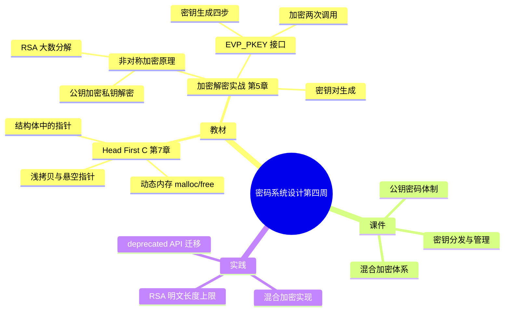

# 密码系统设计

## 第四周预习报告

### 学习内容

- [Head First C 嗨翻 C 语言](https://www.ituring.com.cn/book/1004) 第7章
  - 第7章重点：数据结构与动态内存、`malloc`/`free` 配对、结构体中的指针成员
- [《Windows C/C++加密解密实战》](https://weread.qq.com/web/bookDetail/a0332190813ab78fag011422?wfrom=bookDetailH5)第5章
  - 第5章重点：5.2，5.3，5.5（RSA 与 ECC 原理、密钥对生成、OpenSSL 的 EVP_PKEY 接口）
- [课程 mindmap](https://www.processon.com/mindmap/66bcf83cce68f62ecf3f63fc?from=pwa)

---

### AI 对学习内容的总结（1分）

#### 要求

让 AI（Kimi，元宝等）阅读学习内容并进行总结。

#### 总结

> **1. 动态内存与数据结构（《Head First C》第7章）：** 本章讲怎么用堆上的动态内存管理"长度事先不知道"的数据。`malloc(size)` 按字节申请一块内存并返回起始地址（`void *`），用完必须 `free` 归还，否则这块内存直到进程结束都不会回收，反复泄漏会耗尽内存。结构体里如果存的是指针，就必须区分"结构体本身被复制"和"指针指向的内容被复制"——只浅拷贝结构体会让两个副本指向同一块堆内存，`free` 其中一个后另一个就成了悬空指针。
> <!-- 待确认：我不确定《Head First C》中文版的章节编号是否与英文原版一一对应，这里按"第7章 = 数据结构与动态内存"写，请核对中文版目录。 -->
>
> **2. 非对称加密与 RSA（《Windows C/C++加密解密实战》5.2、5.3）：** 非对称加密用一对数学关联的密钥：公钥加密、私钥解密。RSA 的构造是取两个大素数 p、q，令 n = p·q，φ(n) = (p−1)(q−1)，公开 (n, e)，私钥 d 满足 e·d ≡ 1 (mod φ(n))；加密为 c = m^e mod n，解密为 m = c^d mod n。安全性依赖"从 n 分解出 p、q"这一整数分解难题——公钥可以随便给，因为没有私钥就解不出明文。它的代价是慢，且**单次能加密的明文长度受密钥长度和填充方式限制**：PKCS#1 v1.5 填充下最大为 k−11 字节，OAEP（SHA-256）下为 k−2·hLen−2，2048 位密钥（k=256 字节）时为 256−64−2 = 190 字节。
>
> **3. OpenSSL 的 EVP_PKEY 接口（同上 5.5）：** OpenSSL 3.0 起把算法实现"provider 化"，RSA 推荐用与算法无关的 `EVP_PKEY` 系列接口，而不再用 `RSA_generate_key_ex` 这类低层函数。生成密钥对的顺序是：`EVP_PKEY_CTX_new_id(EVP_PKEY_RSA, NULL)` 建上下文 → `EVP_PKEY_keygen_init` 初始化 → `EVP_PKEY_CTX_set_rsa_keygen_bits` 指定位数 → `EVP_PKEY_keygen` 产出。加密则用 `EVP_PKEY_encrypt_init` + `EVP_PKEY_CTX_set_rsa_padding` + `EVP_PKEY_encrypt`，**且 `EVP_PKEY_encrypt` 要调两次**：第一次 `out = NULL` 只用来取得所需缓冲区长度，第二次才真正写入密文。
> <!-- 待确认：EVP_PKEY_encrypt "第一次 out=NULL 返回所需长度"我按手册写的，但没有亲手验证返回值语义；若你测过请确认。 -->

---

### 对 AI 总结的反思与补充（2分）

#### 要求

- AI总结的问题
- 自己的补充

#### 反思与补充

- **AI 总结的不足**：AI 把 RSA 和对称加密讲成了两套并列的技术，没有点破它们在实际系统里其实是**配套**用的——非对称加密慢、有长度上限，所以只用来传一个对称密钥，真正的大数据交给对称算法，也就是"混合加密"。教材分两章讲，这个组合关系得自己接起来。
- **我的补充**：
  - RSA 的明文长度上限决定了它**不可能**单独承担大数据加密：一套文件加密系统实际是"随机生成 128 位会话密钥 → 用 AES 加密文件 → 用 RSA 公钥加密这个会话密钥"。2048 位 RSA 一次只装得下 190 字节，连一张小图片都装不下。
  - 密钥对不是"随便生成"的：p、q 必须是足够大的素数（2048 位密钥意味着约 1024 位的素数），且随机数源必须高质量。如果 p、q 太接近或随机数可预测，整数分解难度会骤降，私钥就能被算出——教材给了"生成密钥对"的结论，却没强调随机性质量才是安全的地基。
  - 在 C 里管理密钥这类"变长数据"时，《Head First C》第7章的动态内存正好用得上：密钥的长度由算法决定（RSA 私钥长度随密钥位数变化），缓冲区必须用 `malloc` 按 `EVP_PKEY_size()` 动态开，不能写死数组。
  <!-- 待确认：用 EVP_PKEY_size() 取密钥缓冲长度是我结合第7章推的写法，教材 5.5 没明说，属于我的补充，请确认是否保留。 -->

---

### 学习实践过程遇到的问题与解决方式（AI 驱动，优先使用 AI 工具解决问题）（2分）

#### 问题 1：直接用 RSA 公钥加密较长明文，`EVP_PKEY_encrypt` 返回失败

- **出现环境**：Windows 10 + MinGW (GCC) + OpenSSL 3.x。
- **解决过程**：
  1. 先用一段 7 字节短明文测试，`EVP_PKEY_encrypt` 成功；换成 200 多字节的明文后，函数返回 0，错误栈里出现 `rsa_ossl.c` 与 `data too large for key size`。
  2. 一开始以为是缓冲区开小了，按"先 `out = NULL` 调一次取长度"的做法把缓冲开足，仍然失败。
  3. 查手册才明白：问题不在缓冲区，而在 RSA **单次能加密的明文长度本身有上限**——受密钥长度和填充方式限制，与缓冲区无关。
  4. 改为混合加密：随机生成 16 字节会话密钥，用 AES 加密数据，再用 RSA 公钥加密这 16 字节会话密钥，加密顺利通过。
- **经验总结**：RSA 不是通用加密算法，它只负责加密"密钥"或极短数据，长数据一律交给混合加密。加密失败时要区分是"缓冲区不够"还是"明文超过算法上限"，前者靠查长度解决，后者要靠换方案。

#### 问题 2：照抄教程用 `RSA_generate_key_ex`，在 OpenSSL 3.0 下编译失败

- **出现环境**：Windows 10 + MinGW (GCC) + OpenSSL 3.x。
- **解决过程**：
  1. 照一份博客的写法用 `RSA_generate_key_ex` 生成密钥对，编译时出现 `warning: 'RSA_generate_key_ex' is deprecated: Since OpenSSL 3.0`。
  2. 加上 `-Werror` 后警告变成错误，编译直接中断。
  3. 查 OpenSSL 3.0 的 migration guide，发现 3.0 把算法实现 provider 化，一批低层 `RSA_*` 函数被标记 deprecated。
  4. 改用 provider 无关的 `EVP_PKEY_CTX_new_id` + `EVP_PKEY_keygen` 系列接口，重新编译通过。
- **经验总结**：写代码要查**当前版本**的 migration guide，不能照抄只适用于 1.1.1 的博客——低层 API 被弃用后，同样的代码在新版本要么编译不过，要么行为变了。

---

## 参考资料

### AI 工具（你使用的 AI 工具及其链接）

- [OpenCode](https://opencode.ai)
- [DeepSeek](https://chat.deepseek.com/)

### 图书

- [《Windows C/C++加密解密实战》](https://weread.qq.com/web/bookDetail/a0332190813ab78fag011422?wfrom=bookDetailH5)
- [Head First C 嗨翻 C 语言](https://www.ituring.com.cn/book/1004)

### 网站

- [OpenSSL 3.0 迁移指南](https://docs.openssl.org/3.0/man7/migration_guide)
- [EVP_PKEY_encrypt 官方手册](https://docs.openssl.org/3.0/man3/EVP_PKEY_encrypt)

---

### 学习思维导图（2分）

#### 要求

Mermaid 代码与截图，或提交思维导图链接。

#### 思维导图

