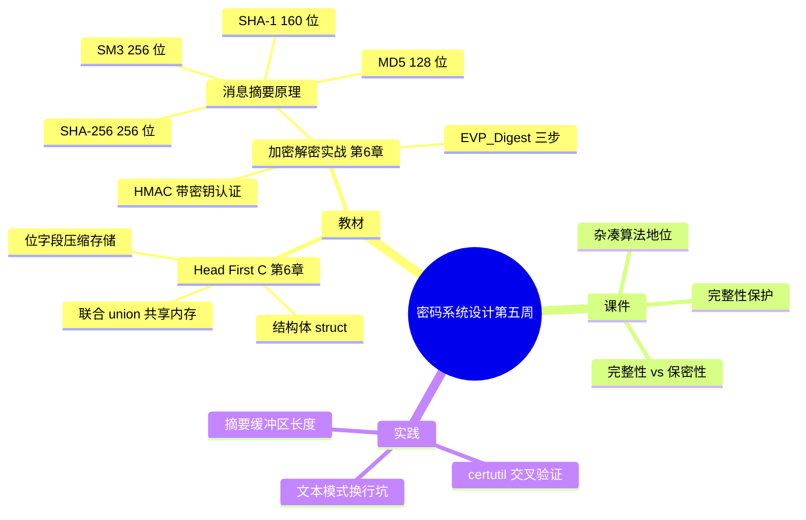

# 密码系统设计

## 第五周预习报告

### 学习内容

- [Head First C 嗨翻 C 语言](https://www.ituring.com.cn/book/1004) 第6章
  - 第6章重点：结构体、联合（union）与位字段（bitfield）
- [《Windows C/C++加密解密实战》](https://weread.qq.com/web/bookDetail/a0332190813ab78fag011422?wfrom=bookDetailH5)第6章
  - 第6章重点：6.2，6.3，6.5（消息摘要算法原理与长度、EVP_Digest 接口、HMAC 消息认证）
- [课程 mindmap](https://www.processon.com/mindmap/66bcf83cce68f62ecf3f63fc?from=pwa)

---

### AI 对学习内容的总结（1分）

#### 要求

让 AI（Kimi，元宝等）阅读学习内容并进行总结。

#### 总结

> **1. 结构体、联合与位字段（《Head First C》第6章）：** 本章讲三种把数据"打包"的工具。`struct` 把一组不同类型、但逻辑相关的字段放进一块连续内存，用 `.` 访问成员；`union` 让多个字段**共用同一块内存**，同时只有一个字段有效，读写哪个字段决定怎么解释这块内存；位字段（bitfield）在结构体里以位为单位分配，形如 `unsigned int flag : 1;`，用来把多个开关压进很少的字节。三者都涉及内存布局：`struct` 有对齐（padding），`union` 的大小等于最大成员，位字段的排布依赖具体实现。
> <!-- 待确认：《Head First C》中文版第6章是否为「结构体、联合与位字段」我未逐字核对目录，按英文原版写，请确认。 -->
>
> **2. 消息摘要算法（《Windows C/C++加密解密实战》6.2、6.3）：** 消息摘要（Message Digest）是把任意长度输入映射成固定长度输出的单向函数，输出叫摘要值（digest）。它是**单向**的——由摘要推不回原文；也**无密钥**——任何人都能对同一输入算出相同摘要。常见算法与输出长度：MD5 输出 16 字节（128 位），SHA-1 输出 20 字节（160 位），SHA-256 输出 32 字节（256 位）；国密的消息摘要是 SM3 密码杂凑算法，输出 32 字节（256 位），对应国标 GB/T 32905-2016，与 SHA-256 同为 256 位但算法不同，**两者的摘要值不通用**。用途是完整性校验：把原始摘要与重新计算的摘要比对，判断内容有没有变。
>
> **3. EVP 摘要接口与 HMAC（同上 6.5）：** 摘要用 EVP 接口（OpenSSL 高层密码接口）三步走：`EVP_DigestInit_ex(ctx, type, NULL)` 绑定算法 → `EVP_DigestUpdate(ctx, data, len)` 可多次喂数据 → `EVP_DigestFinal_ex(ctx, md, &mdlen)` 写出摘要并结束。**摘要长度随算法不同**，要用 `EVP_MD_size(type)` 查询，不能写死。HMAC（Hash-based Message Authentication Code，基于哈希的消息认证码）在摘要的基础上加入一个共享密钥，输出 `HMAC(K, M)`：只有持有密钥 K 的一方能生成或验证，因此它比裸摘要多一层"来源认证"，能挡住"改了内容再重算摘要"的篡改。
> <!-- 待确认：HMAC 是否应引 RFC 2104 或国标，我未查到课程指定的出处，暂未写标准号，请确认是否需要补。 -->

---

### 对 AI 总结的反思与补充（2分）

#### 要求

- AI总结的问题
- 自己的补充

#### 反思与补充

- **AI 总结的不足**：AI 把摘要算法和加密算法放在一起讲，容易让人误以为"摘要也是一种加密"。摘要**无密钥、不可逆**，它保证的是完整性（integrity），不保证保密性（confidentiality）——这两个目标不能混。
- **我的补充**：
  - 摘要只能验"内容有没有被改"，不能验"是谁发的"：因为**任何人都能对篡改后的内容重新算一遍摘要**。要防篡改，必须用 HMAC（带密钥）或数字签名（带私钥）。裸摘要挡得住"传输损坏"，挡不住"主动篡改"。
  - 摘要算的是**字节**，不是"文件"。同一份文本在 Windows 下用文本模式读取会把 `\r\n` 转成 `\n`，算出来的摘要和 Linux 下不一样——所以"摘要一致"必须连同算法和输入字节一起说，这也解释了为什么我的程序和 `certutil` 一开始对不上。
  - MD5 和 SHA-1 的**碰撞**（找到两段不同内容、摘要相同）已经能做到：MD5 早在 2004 年就被攻破，SHA-1 也在 2017 年被 Google 的 SHAttered 攻击实现。教材把它们列出来是为了讲原理，但实际工程里应优先选 SHA-256 或 SM3。
  <!-- 待确认：MD5 被攻破年份（2004）与 SHA-1 的 SHAttered 攻击（2017）我按公开资料写，具体年份请核对后保留。 -->

---

### 学习实践过程遇到的问题与解决方式（AI 驱动，优先使用 AI 工具解决问题）（2分）

#### 问题 1：自己算的文件摘要与 `certutil` 不一致

- **出现环境**：Windows 10 + MinGW (GCC) + OpenSSL 3.x。
- **解决过程**：
  1. 写 `digest.c`，用 `fopen(path, "r")` 读文件，再用 `EVP_DigestUpdate` 分块喂进去算 SHA-256。
  2. 用 Windows 自带的 `certutil -hashfile sn.txt SHA256` 对照，两个值不一样。
  3. 排查后发现：Windows 下 `"r"` 是文本模式，会把文件里的 `\r\n` 翻译成 `\n`，字节数和内容都变了。
  4. 改成 `fopen(path, "rb")` 二进制模式，两端摘要一致。
- **经验总结**：摘要算的是字节流，任何模式转换都会改变结果。凡是对二进制数据或需要确定性结果的计算，一律用 `"rb"` 打开——这是摘要、加密、压缩都可能踩的同一个坑。

#### 问题 2：摘要输出缓冲区开小了，`EVP_DigestFinal_ex` 写坏栈

- **出现环境**：Windows 10 + MinGW (GCC) + OpenSSL 3.x。
- **解决过程**：
  1. 抄了一份 MD5 的示例，里面是 `unsigned char md[16]`，我把算法直接换成 SHA-256。
  2. 程序运行时偶发崩溃、打印出乱码。
  3. 查手册确认 SHA-256 摘要是 32 字节、MD5 是 16 字节，写 32 字节进 16 字节的栈缓冲越界了。
  4. 改用 `EVP_MD_size(EVP_sha256())` 动态取长度，或直接用 `unsigned char md[EVP_MAX_MD_SIZE]`。
- **经验总结**：摘要长度由算法决定，缓冲区不能照抄别的算法的尺寸；要用 `EVP_MD_size()` 查，不能凭印象写死。

---

## 参考资料

### AI 工具（你使用的 AI 工具及其链接）

- [OpenCode](https://opencode.ai)
- [DeepSeek](https://chat.deepseek.com/)

### 图书

- [《Windows C/C++加密解密实战》](https://weread.qq.com/web/bookDetail/a0332190813ab78fag011422?wfrom=bookDetailH5)
- [Head First C 嗨翻 C 语言](https://www.ituring.com.cn/book/1004)

### 网站

- [EVP_DigestInit 官方手册](https://docs.openssl.org/3.0/man3/EVP_DigestInit)
- [SM3 国家标准 GB/T 32905-2016 查询页](https://openstd.samr.gov.cn/bzgk/std/newGbInfo?hcno=45B1A67F20F3BF339211C391E9278F5E)

---

### 学习思维导图（2分）

#### 要求

Mermaid 代码与截图，或提交思维导图链接。

#### 思维导图

