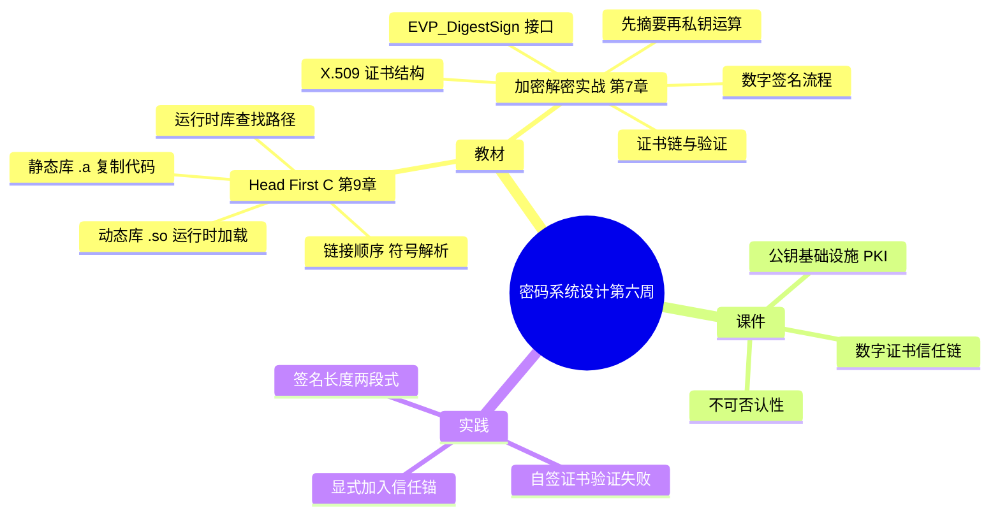

# 密码系统设计

## 第六周预习报告

### 学习内容

- [Head First C 嗨翻 C 语言](https://www.ituring.com.cn/book/1004) 第9章
  - 第9章重点：静态库与动态库（把代码编成 `.a`/`.so` 供复用、静态链接与动态链接的区别、链接顺序与符号解析、运行时库查找路径）
- [《Windows C/C++加密解密实战》](https://weread.qq.com/web/bookDetail/a0332190813ab78fag011422?wfrom=bookDetailH5)第7章
  - 第7章重点：7.2，7.4，7.6（数字签名原理、EVP_DigestSign/Verify 接口、X.509 证书结构与证书链、证书验证流程）
- [课程 mindmap](https://www.processon.com/mindmap/66bcf83cce68f62ecf3f63fc?from=pwa)
  - 公钥基础设施 PKI、数字证书与信任链、不可否认性

---

### AI 对学习内容的总结（1分）

#### 要求

让 AI（Kimi，元宝等）阅读学习内容并进行总结。

#### 总结

> **1. 静态库与动态库（《Head First C》第9章）：** 本章讲把代码变成**可复用库**的两种方式。静态库（static library，`.a`）在**链接时**把用到的目标代码**复制进可执行文件**，程序不依赖外部文件但体积大、更新要重新链接；动态库（shared library，`.so`，Windows 下是 `.dll`）只在链接时记录一个引用，运行时由动态链接器（dynamic linker）查找并加载，多个程序**共享同一份**库代码。链接有顺序讲究：`gcc` 从左到右处理，被依赖的库要放**后面**，否则符号（symbol）解析不到，报 `undefined reference`。运行时找不到动态库时，靠 `LD_LIBRARY_PATH`、`/etc/ld.so.conf` 和 `ldconfig` 缓存来指定搜索路径。
> <!-- 待确认：《Head First C》中文版第9章是否为「静态库与动态库」我未逐字核对目录，按英文原版章节主题写，请确认。 -->
>
> **2. 数字签名（《Windows C/C++加密解密实战》7.2、7.4）：** 数字签名（Digital Signature）**不是对整段明文做私钥运算**，而是**先对消息算摘要、再对摘要做私钥运算**，结果是签名值（signature）。验签时用对应的公钥得到摘要，再与"对原文重算的摘要"比对。它同时给出两点保证：**完整性**——内容被改，摘要就对不上；**不可否认性**——只有持有私钥的人能做出这个签名。签名算法上，RSA PKCS#1 v1.5 对同一密钥、同一消息输出**确定**（相同输入得到相同签名），ECDSA 因每次签名用随机数 k，对同一消息输出**不确定**。
>
> **3. EVP_DigestSign 接口与 X.509 证书（7.6）：** OpenSSL 的 EVP 接口把"摘要 + 签名"合成一步：`EVP_DigestSignInit(ctx, ...)` 绑定密钥与摘要算法 → `EVP_DigestSignUpdate(ctx, data, len)` 可多次喂数据 → `EVP_DigestSignFinal(ctx, sig, &siglen)` 输出签名。X.509 证书的核心字段包括：版本、序列号、签名算法、签发者、有效期、主体、公钥、以及**签发者对以上内容的签名**。把"某公钥属于某人"这件事用一串签名连起来，就是**证书链**（certificate chain），链的顶端是根证书。这套"证书 + 信任链"的体系叫公钥基础设施（Public Key Infrastructure，PKI），签发证书的机构叫证书颁发机构（Certificate Authority，CA）；验证就是逐级验签，直到走到一个事先信任的**信任锚**（trust anchor）。
> <!-- 待确认：X.509 证书字段的标准定义在 RFC 5280，我未逐字核对字段顺序，请确认是否需要补标准号。 -->

---

### 对 AI 总结的反思与补充（2分）

#### 要求

- AI总结的问题
- 自己的补充

#### 反思与补充

- **AI 总结的不足**：AI 把数字签名讲成了一条"摘要 + 私钥运算"的算法链，容易让人以为**签名方案强不强只取决于算法**。但签名值能不能被相信，前提是私钥没泄露——这是**密钥管理**问题，不是**算法**问题，两者必须分开看。AI 通篇没提这一点。
- **我的补充**：
  - 我做完这周最大的体会是：**签名靠私钥保密，私钥一旦泄露，用它签过的东西就全部失效**。签名算法本身再强，私钥保护不到位也没用。所以在我看来，私钥的存储与访问控制，比"选 RSA 还是 ECDSA"更关键。
  - 第二点是：**证书把公钥和身份绑定，但这个绑定是靠信任锚撑着的**。证书链验证的其实是"谁签的这个公钥"，而根一旦不可信，它下面所有证书都可以被伪造。这不是数学问题，是**信任**问题——这也正解释了为什么我用程序验证自签证书会失败。
  <!-- 待确认：数字签名"不可否认性"的成立是否以私钥未泄露为前提，我按工程惯例这样表述，请确认措辞。 -->

---

### 学习实践过程遇到的问题与解决方式（AI 驱动，优先使用 AI 工具解决问题）（2分）

#### 问题 1：用程序校验自签证书，验证始终不通过

- **出现环境**：Windows 10 + MinGW (GCC) + OpenSSL 3.x。
- **解决过程**：
  1. 用 `openssl req -x509 -newkey rsa:2048 -nodes -keyout key.pem -out cert.pem -days 365` 生成一张自签证书。
  2. 程序里用 `SSL_CTX_load_verify_locations(ctx, "ca.pem", NULL)` 加载信任库后校验，报 `verify error:num=18:self-signed certificate`。
  3. 先怀疑是证书过期或主机名不匹配，逐项排除后都不是，验证仍失败。
  4. 查手册后才明白：自签证书的**签发者就是它自己**，信任链里根本没有第三方根 CA，默认的链式校验必然失败。
  5. 把 `cert.pem` 本身显式加入信任库（当作信任锚），验证通过。
- **经验总结**：证书验证的本质是"顺着签名链走到一个已信任的锚点"。自签证书没有上级签发者，就必须把它自己放进信任库当锚点，否则算法再正确也验不过——这是**信任配置**问题，不是证书本身的问题。

#### 问题 2：`EVP_DigestSignFinal` 一次性写入，导致签名长度错误、验签失败

- **出现环境**：Windows 10 + MinGW (GCC) + OpenSSL 3.x。
- **解决过程**：
  1. 照签名示例，分配了一个固定长度的缓冲，直接调 `EVP_DigestSignFinal(ctx, sig, &siglen)`。
  2. 得到的签名长度明显偏小，拿它验签返回失败。
  3. 查手册确认：该函数要**两段式**调用——首次以 `sig = NULL` 传入，只返回所需长度；再按该长度分配缓冲、调第二次才真正写入签名。
  4. 改成"先 `NULL` 探测长度 → 分配 → 再写入"，签名长度正确，验签通过。
- **经验总结**：这类"先问长度再分配"的接口，不能凭一个固定缓冲硬写。先用 `NULL` 探测是 OpenSSL 里反复出现的模式（`EVP_DigestFinal`、`EVP_EncryptFinal` 也是），把它当成惯例记下来，能少踩一堆栈缓冲越界或数据被截断的坑。

---

## 参考资料

### AI 工具（你使用的 AI 工具及其链接）

- [OpenCode](https://opencode.ai)
- [DeepSeek](https://chat.deepseek.com/)

### 图书

- [《Windows C/C++加密解密实战》](https://weread.qq.com/web/bookDetail/a0332190813ab78fag011422?wfrom=bookDetailH5)
- [Head First C 嗨翻 C 语言](https://www.ituring.com.cn/book/1004)

### 网站

- [EVP_DigestSign 官方手册](https://docs.openssl.org/3.0/man3/EVP_DigestSign)
- [RFC 5280：Internet X.509 公钥基础设施证书与 CRL 框架](https://datatracker.ietf.org/doc/html/rfc5280)

---

### 学习思维导图（2分）

#### 要求

Mermaid 代码与截图，或提交思维导图链接。

#### 思维导图

