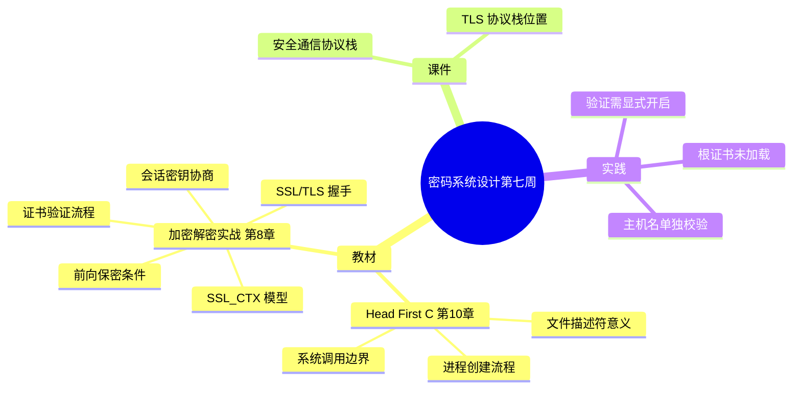

# 密码系统设计

## 第七周预习报告

### 学习内容

- [Head First C 嗨翻 C 语言](https://www.ituring.com.cn/book/1004) 第10章
  - 第10章重点：进程与系统调用（进程创建、文件描述符在进程间的意义、程序与操作系统的交互边界）
- [《Windows C/C++加密解密实战》](https://weread.qq.com/web/bookDetail/a0332190813ab78fag011422?wfrom=bookDetailH5)第8章
  - 第8章重点：8.2，8.4，8.6（握手过程与会话密钥协商、证书验证、SSL_CTX 与 SSL 对象编程模型、前向保密）
- [课程 mindmap](https://www.processon.com/mindmap/66bcf83cce68f62ecf3f63fc?from=pwa)
  - 安全通信协议栈、TLS 在应用层与传输层之间的位置

---

### AI 对学习内容的总结（1分）

#### 要求

让 AI（Kimi，元宝等）阅读学习内容并进行总结。

#### 总结

> **1. 进程与系统调用（《Head First C》第10章）：** 本章讲"程序怎么和操作系统打交道"。要创建进程用 `fork()`——它复制出当前进程的一个副本，父子进程各自继续往下执行；再用 `exec` 系列函数把副本替换成另一个程序。进程之间靠**文件描述符（file descriptor）**读写数据：描述符是一张小整数表，标准输入 / 输出 / 错误固定占 0 / 1 / 2 三个。程序很多"能力"（读文件、开 socket、申请内存）本质上都是**系统调用（system call）**——用户态代码通过它陷入内核，由内核代为执行。这也解释了为什么程序会依赖运行环境里的系统资源，换个机器行为就可能不同。
> <!-- 待确认：《Head First C》中文版第10章标题是否为「进程与系统调用」，我未逐字核对目录，请确认。 -->
>
> **2. SSL/TLS 安全通信（《Windows C/C++加密解密实战》第8章）** —— 本章重点按三节展开：
>
> **8.2 握手与会话密钥协商：** SSL/TLS（Secure Sockets Layer / Transport Layer Security）握手时客户端先发 ClientHello、服务端回 ServerHello，双方协商出算法套件与随机的**会话密钥（session key）**；之后的应用数据都用这把对称密钥加密，非对称运算只用在握手开头，成本因此可控。
> <!-- 待确认：第8章的 8.2/8.4/8.6 分别对应"握手协商 / 编程模型 / 证书验证与前向保密"，我按输入提纲这样落位，小节标题请核对。 -->
>
> **8.4 SSL_CTX 与 SSL 编程模型：** OpenSSL 用两层对象组织：`SSL_CTX`（上下文，存证书、方法、选项，进程内通常一个）和 `SSL`（一条具体连接，可多条）。典型流程是 `TLS_client_method` → `SSL_CTX_new` → `SSL_new` → `SSL_connect`。
>
> **8.6 证书验证与前向保密：** 证书链验证回答的是"对端证书由谁签发、是否可信任"；**前向保密（Perfect Forward Secrecy，PFS）** 则保证"服务器长期私钥日后泄露，之前的会话流量也解不开"——**前提是用了 ECDHE 这类临时密钥交换**；若用 RSA 静态密钥交换，长期私钥一旦泄露，历史流量即可被解密。
> <!-- 待确认：前向保密"依赖临时密钥交换（ECDHE）"的表述我按公开资料写，请确认与教材口径一致。 -->

---

### 对 AI 总结的反思与补充（2分）

#### 要求

- AI总结的问题
- 自己的补充

#### 反思与补充

- **AI 总结的不足**：AI 把 TLS 讲成了"握手 → 协商密钥 → 加密传输"的流水线，容易让人以为**"能加密 = 安全了"**。但保密性和认证性是两回事：不验证对方身份，加密也只是"和中间人安全地聊天"。而 OpenSSL 的默认恰好是**不验证书**——AI 完全没提这个默认值，而这正是我第一次连接失败的根因。
- **我的补充**：
  - 我做完这周的体会是：**TLS 的保密性和认证性是两回事**。会话密钥协商成功只保证"通道被加密了"，不等于"我连的是对的那台机器"。验证必须**显式开启**，而且**还要单独校主机名**——这两道我都踩过坑：先是没开验证，后是开了验证却没校主机名。
  - 第二点是：**前向保密是有条件的**。只有用 ECDHE 这类临时密钥交换才有前向保密；用 RSA 静态密钥交换的旧套件，长期私钥一旦泄露，历史流量就能被解密。所以"支持 TLS"不等于"具备前向保密"，得看套件里用的密钥交换方式。

---

### 学习实践过程遇到的问题与解决方式（AI 驱动，优先使用 AI 工具解决问题）（2分）

#### 问题 1：`SSL_connect` 返回错误，握手因证书验证失败走不通

- **出现环境**：Windows 10 + MinGW (GCC) + OpenSSL 3.x。
- **解决过程**：
  1. 用 `TLS_client_method` 建 `SSL_CTX`，连一个公网站点，握手没走通。
  2. `SSL_connect` 返回 ≤ 0，`SSL_get_error` 指向证书验证失败。
  3. 排查发现：根本没给 `SSL_CTX` 加载根证书——OpenSSL **默认不加载系统根证书**。
  4. 补上 `SSL_CTX_set_default_verify_paths()`，并显式调用 `SSL_CTX_set_verify(ctx, SSL_VERIFY_PEER, NULL)`。
  5. 握手成功。
- **经验总结**：OpenSSL 的安全默认是"关着的"——既不带根证书、也不主动验对方。要用它做安全通信，必须**自己把验证打开、把信任库装上**。"能不能加密"和"敢不敢信任对端"是两套独立开关，只开前者等于裸奔。

#### 问题 2：证书链验证通过了，主机名不匹配却没被拦下来

- **出现环境**：Windows 10 + MinGW (GCC) + OpenSSL 3.x。
- **解决过程**：
  1. 验证打通之后，出于好奇，拿一个"证书域名与实际访问域名不符"的站点测试。
  2. 连接居然成功——证书链是有效的，但主机名 mismatch 没有被拦。
  3. 查手册才明白：证书链验证只校"签发关系"，主机名要**另用** `SSL_set1_host()` 或 `X509_check_host()` 校验。
  4. 加上 `SSL_set1_host(ssl, host)` 后，再测就被正确拦截。
- **经验总结**："证书链有效"不等于"这就是我要连的那台机器"。链验证回答"谁签的"，主机名验证回答"签的是不是我要的域名"——这是两道独立校验，少一道就等于给中间人留了门。

---

## 参考资料

### AI 工具（你使用的 AI 工具及其链接）

- [OpenCode](https://opencode.ai)
- [DeepSeek](https://chat.deepseek.com/)

### 图书

- [《Windows C/C++加密解密实战》](https://weread.qq.com/web/bookDetail/a0332190813ab78fag011422?wfrom=bookDetailH5)
- [Head First C 嗨翻 C 语言](https://www.ituring.com.cn/book/1004)

### 网站

- [SSL_CTX_set_verify 官方手册](https://docs.openssl.org/3.0/man3/SSL_CTX_set_verify)
- [SSL_set1_host / X509_check_host 官方手册](https://docs.openssl.org/3.0/man3/X509_check_host)

---

### 学习思维导图（2分）

#### 要求

Mermaid 代码与截图，或提交思维导图链接。

#### 思维导图

