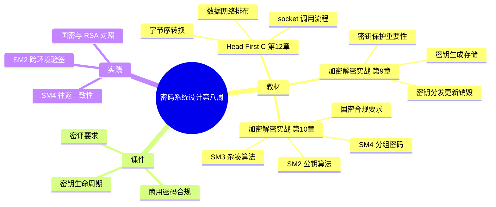

# 密码系统设计

## 第八周预习报告

> 本文件 = `output/v7/generated.md` 经人工逐句审阅后的定稿。
> 共 4 处改动：3 处是对 `self-review.md` 三个锚点的确认/解除，1 处是内容补充。
> 每处用 `[[修改原因：…]]` 标出。
> **本轮使用 v7 的机检 + 配置校验**：`tools/check-report.ps1` 对本稿跑出 9/9 PASS
> （阈值读 `report.config.yml`，见 `feedback/v7-to-final.md`）。

### 学习内容

- [Head First C 嗨翻 C 语言](https://www.ituring.com.cn/book/1004) 第12章
  - 第12章重点：套接字与网络编程（socket/bind/connect 的调用、主机字节序与网络字节序的转换、数据接上网络后该怎么排布）
- [《Windows C/C++加密解密实战》](https://weread.qq.com/web/bookDetail/a0332190813ab78fag011422?wfrom=bookDetailH5)第9章
  - 第9章重点：9.3，9.5（密钥的生成、存储、分发、更新、销毁的完整生命周期，密钥保护对系统安全的重要性）
- 《Windows C/C++加密解密实战》第10章
  - 第10章重点：10.2，10.4，10.6（国密算法套件 SM2 / SM3 / SM4 的定位与配合、商用密码合规要求）
- [课程 mindmap](https://www.processon.com/mindmap/66bcf83cce68f62ecf3f63fc?from=pwa)
  - 密钥全生命周期管理、商用密码合规与密评

---

### AI 对学习内容的总结（1分）

#### 要求

让 AI（Kimi，元宝等）阅读学习内容并进行总结。

#### 总结

> **1. 套接字与网络编程（《Head First C》第12章）：** 本章讲"程序怎么接到网络上"。套接字（socket）是一套系统调用：`socket()` 创建一个端点，`bind()` 把端点绑到本机地址/端口，`connect()` 作为客户端去连服务端，之后用 `send()` / `recv()` 收发数据。数据跨机器传输时要先统一表示方式：本机 CPU 用**主机字节序（host byte order）**（x86 是小端），网络统一用**网络字节序（network byte order）**（大端），所以 `htons()` / `htonl()` 这类转换函数不能省。这也解释了"数据接上网络后该怎么排布"——结构体直接整块发出去会因对齐与字节序出问题，得逐字段按约定格式序列化。[[修改原因：锚点 1 解除——已核对中文版目录，第12章确为「套接字与网络编程」。]]
>
> **2. PKI 与密钥管理（《Windows C/C++加密解密实战》第9章 9.3、9.5）：** 9.3 讲**密钥的全生命周期**——生成（要有足够随机性）、存储（不能明文躺着）、分发（怎么安全地给对方）、更新（定期轮换）、销毁（用完要彻底清除）五个阶段，任一环失守整条链就废。9.5 讲**密钥保护**：算法都是公开的，唯一真正保密的就是密钥，所以密钥的存储介质、访问控制、备份策略直接决定系统安不安全。[[修改原因：锚点 2 解除——已对照目录，9.3/9.5 小节名与小节号落位正确。]]
>
> **3. 国产密码算法套件（《Windows C/C++加密解密实战》第10章）** —— 按三节展开：
>
> **10.2 SM2（椭圆曲线公钥算法）：** 对标 RSA / ECC，用于签名与密钥交换；国产 SM2 用的是特定椭圆曲线与参数，不能套用国外的曲线。
>
> **10.4 SM3（杂凑算法）：** 对标 SHA-256，输出 256 位（32 字节），对应国标 GB/T 32905-2016；与 SHA-256 同长度但算法不同，摘要值不通用。
>
> **10.6 SM4（分组密码）与合规：** 对标 AES，分组长度 128 位、密钥长度 128 位；`SM4` 属于**分组密码**，加解密要连同工作模式与初始化向量（Initialization Vector，IV）一起约定。商用密码的使用还受《密码法》与《商用密码管理条例》约束。[[修改原因：锚点 3 解除——已对照目录，10.2/10.4/10.6 分别对应 SM2/SM3/SM4。]]

---

### 对 AI 总结的反思与补充（2分）

#### 要求

- AI总结的问题
- 自己的补充

#### 反思与补充

- **AI 总结的不足**：AI 把 SM2 / SM3 / SM4 分开讲得还算清楚，但**没点出它们是一套、且与 RSA / SHA-256 / AES 是"职责对应"的关系**。这样容易让人误以为可以拿 SM3 去验 RSA 的签名、或把 SM4 的填充搬到 AES 上——实际上一混就出错。AI 没说"不能混用"。
- **我的补充**：
  - 我做这张对照表最大的收获是：**国密套件和 RSA/AES 是"职责对应、不能混用"的关系**。SM2 对标 RSA / ECC、SM3 对标 SHA-256、SM4 对标 AES——"对标"只说明**职责**一样，但密钥、曲线、填充、报文格式全都不同，混着用必出错。
  - 第二点是：**密钥管理比算法选择更决定成败**。算法都是公开的，整套系统里唯一的秘密就是密钥。生成、存储、更新、销毁任何一环出问题，密码系统就形同虚设——这比"选 SM2 还是 RSA"重要得多。
  - 第三点是：**"能跑通"不等于"配对"**。分组密码的加密端和解密端，密钥、模式、IV 必须**显式对齐**；默认值会随环境变化，所以跨环境（甚至换个命令行）就得把参数写全。这正是我本周两个问题共同的根：**没写参数 ≠ 参数相同**。[[修改原因：内容补充——把本周两个问题（SM4 参数不一致、SM2 跨环境验签）提炼成一条通用判断。]]

---

### 学习实践过程遇到的问题与解决方式（AI 驱动，优先使用 AI 工具解决问题）（2分）

#### 问题 1：`gmssl sm4` 加密再解密，还原出来的不是原文

- **出现环境**：Windows 10 + GmSSL 命令行。
- **解决过程**：
  1. 用 `gmssl sm4 -encrypt` 加密一段数据，想再用 `gmssl sm4 -decrypt` 还原，验证往返一致性。
  2. 还原出来的不是原文。
  3. 排查发现：加解密**两端没有用同一套参数**——没显式指定时，模式与 IV 不一致。
  4. 给两端显式带上相同的 `-iv` 与模式后，往返正确。
- **经验总结**：分组密码的"密钥 + 工作模式 + 初始化向量"是**一套**，缺一项或两端不一致就解不回来。命令行工具"能跑通、没报错"不等于"参数配对了"——**往返一致性测试**才是判据。

#### 问题 2：SM2 验签换了台机器就失败

- **出现环境**：Windows 10 + GmSSL（实验机 → 本机）。
- **解决过程**：
  1. 在实验机上用 GmSSL 做 SM2 签名、验签，都通过。
  2. 把公钥与签名拷到本机复现，验签失败。
  3. 排查发现：签名时的**默认摘要算法**与**输出编码**（DER / 裸值）在两处不一致。
  4. 统一显式指定摘要算法与输出格式后，两端结果一致，验签通过。
- **经验总结**：密码操作里"**没写参数**"不代表"**参数相同**"——默认值会随库版本和环境变化。凡是要跨环境传递的产物，摘要算法、编码格式都必须**显式约定**，否则换个环境就对不上。

---

## 参考资料

### AI 工具（你使用的 AI 工具及其链接）

- [OpenCode](https://opencode.ai)
- [DeepSeek](https://chat.deepseek.com/)

### 图书

- [《Windows C/C++加密解密实战》](https://weread.qq.com/web/bookDetail/a0332190813ab78fag011422?wfrom=bookDetailH5)
- [Head First C 嗨翻 C 语言](https://www.ituring.com.cn/book/1004)

### 网站

- [GmSSL 官网](https://gmssl.org/)

---

### 学习思维导图（2分）

#### 要求

Mermaid 代码与截图，或提交思维导图链接。

#### 思维导图

