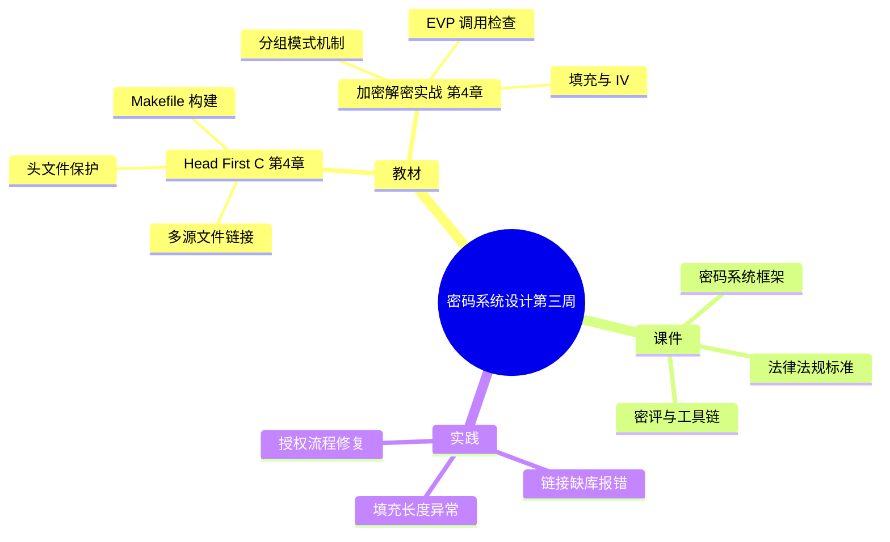

# 密码系统设计

## 第三周预习报告

### 学习内容

- [Head First C 嗨翻 C 语言](https://www.ituring.com.cn/book/1004) 第4章
  - 第4章重点：多源文件编译与链接、头文件与头文件保护、声明与定义分离、模块化设计、Makefile 构建
- [《Windows C/C++加密解密实战》](https://weread.qq.com/web/reader/a0332190813ab78fag011422?wfrom=reader)第4章
  - 第4章重点：4.2，4.3，4.5（分组密码的工作模式、填充机制、密钥与 IV 的作用、OpenSSL EVP 接口调用与返回值检查、编译链接选项）
- [课程 mindmap](https://www.processon.com/mindmap/66bcf83cce68f62ecf3f63fc?from=pwa)
  - 网络空间安全框架、密码系统、法律法规与标准、密码应用与密评、工具链

---

### AI 对学习内容的总结（1分）

#### 要求

让 AI（Kimi，元宝等）阅读学习内容并进行总结。

#### 总结

> **1. 多源文件与构建（《Head First C》第4章）：** 本章讲"把一个程序拆成多个源文件"。头文件放声明（`aes.h` 写函数原型与常量），源文件放定义（`aes.c` 写实现），`main.c` 只管调用，编译时分别 `-c` 成目标文件再链接成 exe。头文件要用 `#ifndef` / `#define` / `#endif` 防重复包含（头文件保护）。当源文件变多，用 **Makefile** 描述"谁依赖谁、怎么生成"，`make` 只重编改动过的部分。
> <!-- 待确认：加密解密实战第4章的 4.2 / 4.3 / 4.5 是否分别对应「分组工作模式」「填充与密钥、IV」「EVP 接口与编译链接」，我按输入提纲这样落位，小节号与小节名请核对。 -->
>
> **2. 分组密码的工作模式与 EVP 接口（加密解密实战 第4章）** —— 按三节展开：
>
> **4.2 工作模式：** 分组密码一次只处理一个固定长度的分组，模式决定"多块如何串起来"。ECB 各块独立、相同明文块得到相同密文块（不安全）；CBC 用前一块密文参与异或、需一个 IV；CFB / OFB / CTR 把分组密码当流密码用，逐字节/逐位产生密钥流。
>
> **4.3 填充与密钥、IV：** 明文长度不是分组长度的整数倍时要填充。OpenSSL EVP 默认使用 **PKCS 填充**：补 b 个值为 b 的字节（1 ≤ b ≤ 分组大小）；明文已是整数倍时再补一整块。密钥是加解密的核心秘密；CBC 模式还必须有 IV。
>
> **4.5 EVP 接口调用与编译链接：** 用 `EVP_EncryptInit_ex()` 初始化、`EVP_EncryptUpdate()` 处理数据、`EVP_EncryptFinal_ex()` 收尾。`EVP_CIPHER_CTX_set_padding(ctx, 0)` 可关闭填充，**必须在 `EVP_EncryptInit_ex()` 之后调用**；关闭填充后 `EVP_EncryptFinal_ex()` 不再处理尾部不足一整块的数据。`EVP_EncryptInit_ex()` 属 `libcrypto`，给编译命令补 `-lcrypto` 才能链接。

---

### 对 AI 总结的反思与补充（2分）

#### 要求

- AI总结的问题
- 自己的补充

#### 反思与补充

- **AI 总结的不足**：AI 把各个工作模式的**流程**讲清楚了，但**没讲 IV 复用的安全代价**——教材只描述"流程"，不点破"用错会怎样"。
- **我的补充**：
  - **IV 复用的安全代价**：教材讲了各工作模式的流程，但没讲 CBC 的 IV 每次都必须不同、IV 复用会泄露明文前缀的相等关系。两个明文块如果前缀相同、又复用同一 IV，密文前缀也会相同，攻击者据此可推断明文内容——**这是"能看出规律"级别的泄露**。
  - **第4章主题与第3章知识撞车**：声明/定义分离、链接顺序这些第4章的原理，正好解释了 `-lcrypto` 为什么会 `undefined reference`，但教材没把两者联系起来。**第4章的"链接原理"是第3章那类报错的答案。**

---

### 学习实践过程遇到的问题与解决方式（AI 驱动，优先使用 AI 工具解决问题）（2分）

#### 问题 1：多文件 AES 程序链接报错、填充长度异常

- **出现环境**：Windows + MinGW (GCC)，编译多源文件 AES 加解密程序（`aes.h` / `aes.c` / `main.c`）。
- **解决过程**：
  1. 分别编译三个源文件（`-c`）都能过，最后链接 exe 时报 `undefined reference to 'EVP_EncryptInit_ex'`。
  2. 排查发现 `EVP_EncryptInit_ex()` 属 `libcrypto`，链接命令少了链接选项。
  3. 补上 `-lcrypto`（目标文件在前、`-lcrypto` 在后）后链接通过。
  4. 运行时用 7 字节明文测试，加密结果异常：输出长度不对。
  5. 排查发现明文长度不是 16 的整倍数，填充处理不对；确认 EVP 默认启用 PKCS 填充，关闭填充后必须自行保证数据为块大小整数倍。
- **经验总结**：编译能过不代表链接能过——**声明（头文件）和定义（库）是两件事**，`undefined reference` 是链接器"找不到定义"的报错。数据长度问题要回到"是不是分组大小的整数倍"这个根上。

#### 问题 2：OpenCode 执行命令时被授权拦截

- **出现环境**：Windows + OpenCode 智能体，尝试自动完成环境安装与导出脚本。
- **解决过程**：
  1. 用 OpenCode 智能体尝试自动完成环境安装与导出脚本，命令被拦截。
  2. 提示 `Device approval failed`，依赖脚本无法执行。
  3. 重新走设备码/浏览器授权登录流程。
  4. 授权状态恢复后，同一命令正常执行。
- **经验总结**：这是**设备授权需要终端与网页交互**的机制，属于 AI 智能体无法直接完成的环节，不是权限配置错误。遇到授权类报错，先查"是不是需要人参与的一次性授权"，而不是反复重试命令。

---

## 参考资料

### AI 工具（你使用的 AI 工具及其链接）

- [OpenCode](https://opencode.ai)
- [DeepSeek](https://chat.deepseek.com/)

### 图书

- [《Windows C/C++加密解密实战》](https://weread.qq.com/web/reader/a0332190813ab78fag011422?wfrom=reader)
- [Head First C 嗨翻 C 语言](https://www.ituring.com.cn/book/1004)

### 网站

- [OpenSSL 3.0 手册 · EVP_EncryptInit](https://docs.openssl.org/3.0/man3/EVP_EncryptInit)
- [Head First C 逐章学习笔记（英文版章号参考）](https://github.com/DaviNakamuraCardoso/c)

---

### 学习思维导图（2分）

#### 要求

Mermaid 代码与截图，或提交思维导图链接。

#### 思维导图

