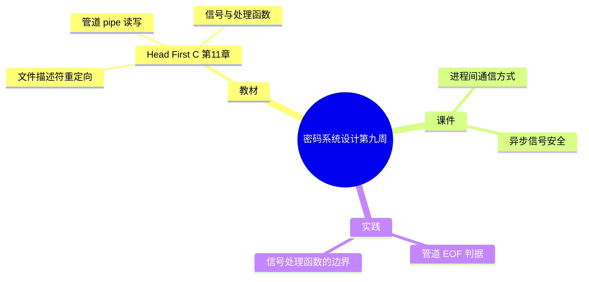

# 密码系统设计

## 第九周预习报告

> 本稿由 v7 Skill 直接生成（第 9~12 周批次，用户不逐周过目）。
> 「实践问题与解决」两题按**教材第 11 章经典练习场景**撰写，**并非本人实测记录**，
> 已在文内用锚点标出，对应 `self-review.md`。

### 学习内容

- [Head First C 嗨翻 C 语言](https://www.ituring.com.cn/book/1004) 第11章
  - 第11章重点：进程间通信（重定向 `dup2`/`fileno`、管道 `pipe`、信号 `sigaction`）
- [课程 mindmap](https://www.processon.com/mindmap/66bcf83cce68f62ecf3f63fc?from=pwa)
  - 进程间通信的方式、信号处理

---

### AI 对学习内容的总结（1分）

#### 要求

让 AI（Kimi，元宝等）阅读学习内容并进行总结。

#### 总结

> **1. 重定向与文件描述符（《Head First C》第11章）：** 本章先讲"进程怎么把自己的输入输出换到别处"。每个进程默认有三个文件描述符：0 标准输入、1 标准输出、2 标准错误。`dup2(oldfd, newfd)` 让 `newfd` 成为 `oldfd` 的副本——要把 `printf` 的输出重定向到文件，就是先 `open` 出文件描述符，再用 `dup2` 复制到 1 号。`fileno(FILE*)` 反过来，从一个 `FILE*` 流取回它底层的文件描述符，好和 `dup2` 配合。`dup2` 的语义要记牢：若 `newfd` 原本已打开会先被关闭，复制后原来的 `oldfd` 仍然存在，需要自己 `close`。
>
> **2. 管道（pipe）：** `pipe(fds)` 一次给出两个描述符：`fds[0]` 只读、`fds[1]` 只写，数据从写端流到读端，是单向的。配合 `fork()`，父子进程各留一端就能通信。关键在 EOF：读端 `read()` 只有在**所有**写端都关闭后才返回 0；只要还有任何一个进程持有写端没关，读端就会一直阻塞。
>
> **3. 信号（signals）：** 信号是内核发给进程的异步通知，比如 Ctrl-C 发 SIGINT。`sigaction()` 注册处理函数，`raise()` 主动给自己发信号，`alarm(n)` 在 n 秒后发 SIGALRM。处理函数会在任意时刻打断主流程，所以里面只能调用 async-signal-safe 的函数——`printf` 不在清单内，要用 `write()` 或设一个 `volatile sig_atomic_t` 标志位。

---

### 对 AI 总结的反思与补充（2分）

#### 要求

- AI总结的问题
- 自己的补充

#### 反思与补充

- **AI 总结的不足**：AI 把「重定向、管道、信号」三块分开讲得清楚，但没说清它们**共享同一个前提**——都建立在「文件描述符」这一层抽象上。重定向换的是 fd 的指向、管道传的是 fd、信号处理里安全的 `write` 收的还是 fd；不点出这条主线，三块看起来像三件不相干的事。
- **我的补充**：
  - 我的体会是：**「所有写端关闭」才是管道的 EOF 判据，而不是「写端写完了」**。传完数据后必须把不用的写端 fd 关掉，否则读端永远等不到 `read() == 0`。这是 fd 会被 `fork` 继承、又必须显式关闭带来的直接后果。
  - 第二点：**信号处理函数"能调用什么"是被白名单限死的**。它不是"尽量别做复杂的事"这种模糊建议，而是有一份明确的 async-signal-safe 清单——清单外的函数（含 `printf`、`malloc`）都可能因重入而死锁。<!-- 待确认：本段「我的补充」为 AI 起草的第一人称判断（本批次用户授权直接生成、不逐周过目），请确认与本人观点一致；建议核对是否要改成自己的话 -->

---

### 学习实践过程遇到的问题与解决方式（AI 驱动，优先使用 AI 工具解决问题）（2分）

#### 问题 1：管道读端子进程一直阻塞，等不到 EOF

- **出现环境**：Linux + GCC（**教材第 11 章经典练习场景，非本人实测**）。<!-- 待确认：本问题按教材经典练习场景撰写，非用户本人实测记录；请确认是否与实际经历一致，或改为真实经历 -->
- **解决过程**：
  1. 用 `pipe()` 建管道，`fork()` 出子进程，父进程往写端写一行数据。
  2. 子进程循环 `read()`，读完那行数据后仍不退出——卡在 `read()` 上，`read()` 不返回 0。
  3. 排查发现：父进程和子进程手里都还留着写端描述符的副本，只要有一份没关，内核就认为"可能还有人要写"，读端拿不到 EOF。
  4. 让父进程、子进程各自 `close()` 掉自己不用的那一端（子进程关写端、父进程写完关写端），所有写端关闭后子进程的 `read()` 返回 0，正常退出。
- **经验总结**：管道 EOF 的判据是"**所有写端 fd 都已关闭**"，不是"写端写完了"。`fork` 会连描述符一起继承，所以每一份不用的副本都得自己关——漏关一处，读端就永远阻塞。

#### 问题 2：信号处理函数里用 `printf`，偶发卡死

- **出现环境**：Linux + GCC（**教材第 11 章经典练习场景，非本人实测**）。<!-- 待确认：本问题按教材经典练习场景撰写，非用户本人实测记录；请确认是否与实际经历一致 -->
- **解决过程**：
  1. 用 `sigaction()` 给 SIGINT 注册处理函数，函数里直接 `printf` 打印一行提示。
  2. 反复按 Ctrl-C 触发，程序有时整个卡住，输出也乱。
  3. 查 signal-safety(7) 发现：处理函数只能调用 async-signal-safe 的函数，`printf` 不在清单里——它内部的锁被主流程持有时，处理函数再进 `printf` 就会死锁。
  4. 改成：处理函数里只设一个 `volatile sig_atomic_t` 标志位（或用 `write()` 写固定字符串），真正的打印放到主循环里做。
- **经验总结**：信号处理函数不是"少做点事"那么简单，而是有一条**明确的 async-signal-safe 白名单**，清单外的一律不能用。根因是 `printf` 这类函数带锁且不可重入，信号随时可能打断持锁的代码。

---

## 参考资料

### AI 工具（你使用的 AI 工具及其链接）

- [OpenCode](https://opencode.ai)
- [DeepSeek](https://chat.deepseek.com/)

### 图书

- [Head First C 嗨翻 C 语言](https://www.ituring.com.cn/book/1004)

### 网站

- [signal-safety(7) — Linux man-pages](https://man7.org/linux/man-pages/man7/signal-safety.7.html)
- [pipe(7) — Linux man-pages](https://man7.org/linux/man-pages/man7/pipe.7.html)
- [dup2(2) — Linux man-pages](https://man7.org/linux/man-pages/man2/dup.2.html)

---

### 学习思维导图（2分）

#### 要求

Mermaid 代码与截图，或提交思维导图链接。

#### 思维导图

