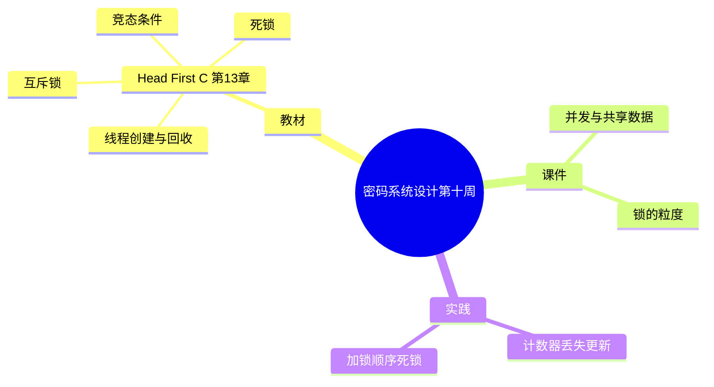

# 密码系统设计

## 第十周预习报告

> 本稿由 v7 Skill 直接生成（第 9~12 周批次，用户不逐周过目）。
> 「实践问题与解决」两题按**教材第 13 章经典练习场景**撰写，**并非本人实测记录**，
> 已在文内用锚点标出，对应 `self-review.md`。

### 学习内容

- [Head First C 嗨翻 C 语言](https://www.ituring.com.cn/book/1004) 第13章
  - 第13章重点：线程（`pthread_create`/`pthread_join`、竞态条件、互斥锁、死锁）
- [课程 mindmap](https://www.processon.com/mindmap/66bcf83cce68f62ecf3f63fc?from=pwa)
  - 并发、共享数据与锁

---

### AI 对学习内容的总结（1分）

#### 要求

让 AI（Kimi，元宝等）阅读学习内容并进行总结。

#### 总结

> **1. 线程的创建与回收（《Head First C》第13章）：** 线程是同一进程内可以并行执行的执行流，多个线程共享该进程的地址空间（全局变量、堆都能互相看见）。`pthread_create(&t, NULL, start, arg)` 起一个新线程：`start` 是新线程的入口函数，`arg` 是传给它的参数，成功返回 0、失败返回非零错误码（不设 errno）。主线程用 `pthread_join(t, NULL)` 等它结束并回收资源——不 join 的线程会留下不可回收的资源。`start` 返回 `NULL` 即表示该线程结束。
>
> **2. 竞态条件与互斥锁：** 多个线程读写同一份数据时，执行顺序由调度决定。像 `count++` 这种操作在汇编层是"读→加→写"三步，两步之间可能被打断，于是两个线程的更新互相覆盖（丢失更新），结果随每次运行而变——这就是竞态条件。保护办法是给临界区加互斥锁：`pthread_mutex_lock(&m)` 进入、`pthread_mutex_unlock(&m)` 退出，同一时刻只有一个线程能拿到锁，交错就被消除了。
>
> **3. 死锁：** 当线程 A 持有 m1 去等 m2、线程 B 持有 m2 去等 m1，双方都在等对方释放，谁都不动——形成循环等待。死锁的四个必要条件为互斥、持有并等待、不可抢占、循环等待；最实用的破法是破坏"循环等待"：让所有线程按**同一顺序**加锁，就不会形成环。

---

### 对 AI 总结的反思与补充（2分）

#### 要求

- AI总结的问题
- 自己的补充

#### 反思与补充

- **AI 总结的不足**：AI 讲清了"竞态→加锁→死锁"这条线，但把锁讲成了"加了就安全"的万能药，**没提锁本身带来的两个代价**：一是锁粒度——临界区包得太大就把并发吃光、包得太小又保护不住共享状态；二是加锁顺序——同一批锁在不同地方用不同顺序获取，就会埋下死锁。这两点才是实际写并发程序时最容易翻车的地方。
- **我的补充**：
  - 我的体会是：**竞态条件的判据是"结果随调度变化"，不是"结果错了"**。它可能这次对、下次错，所以"多跑几次没问题"完全不能说明没有竞态——必须从"这段代码有没有非原子的共享读改写"上去看。<!-- 待确认：本段「我的补充」为 AI 起草的第一人称判断（本批次用户授权直接生成、不逐周过目），请确认与本人观点一致；建议核对是否要改成自己的话 -->
  - 第二点：**解锁不只是"保护数据"，更是"约定顺序"**。与其事后排查死锁，不如一开始就规定所有线程按同一顺序加锁——把并发正确性变成一条能检查的纪律，而不是靠运气。

---

### 学习实践过程遇到的问题与解决方式（AI 驱动，优先使用 AI 工具解决问题）（2分）

#### 问题 1：两个线程各自自增同一个计数器，结果比预期小

- **出现环境**：Linux + GCC（**教材第 13 章经典练习场景，非本人实测**）。<!-- 待确认：本问题按教材经典练习场景撰写，非用户本人实测记录；请确认是否与实际经历一致，或改为真实经历 -->
- **解决过程**：
  1. 用 `pthread_create()` 起两个线程，各自把同一个全局 `int count` 自增 100000 次。
  2. 两次 `pthread_join` 后打印 `count`，预期 200000，实际在十几万之间波动，且每次都不一样。
  3. 排查发现：`count++` 不是原子操作，是"读-改-写"三步，两线程的每一步都可能交错，导致有的自增被覆盖（丢失更新）。
  4. 用 `pthread_mutex_lock`/`unlock` 把整个 `count++` 包成临界区，再跑多次，结果稳定为 200000。
- **经验总结**：竞态条件的根因是"**对共享状态的非原子读改写**"，而不是"线程跑太快"。判据是结果随调度变化——所以"多跑几次没错"证明不了没问题，得从代码结构上看有没有浮在外面的共享自增。

#### 问题 2：两个线程以相反顺序加两把锁，程序双双挂起

- **出现环境**：Linux + GCC（**教材第 13 章经典练习场景，非本人实测**）。<!-- 待确认：本问题按教材经典练习场景撰写，非用户本人实测记录；请确认是否与实际经历一致 -->
- **解决过程**：
  1. 建两把互斥锁 m1、m2。线程 A 先锁 m1 再锁 m2，线程 B 先锁 m2 再锁 m1。
  2. 运行后两个线程都停住，主线程 `pthread_join` 永不返回，程序挂起。
  3. 排查发现：A 拿着 m1 等 m2、B 拿着 m2 等 m1，正好凑齐循环等待。
  4. 把两个线程的加锁顺序统一（都先 m1 后 m2），死锁消失。
- **经验总结**：死锁的根因是"**循环等待**"——只要有环就可能僵住，与线程多少无关。最实用的破法是全局规定一致的加锁顺序；反过来，只要出现"在两个地方按不同顺序抢同一批锁"，就应视为死锁隐患。

---

## 参考资料

### AI 工具（你使用的 AI 工具及其链接）

- [OpenCode](https://opencode.ai)
- [DeepSeek](https://chat.deepseek.com/)

### 图书

- [Head First C 嗨翻 C 语言](https://www.ituring.com.cn/book/1004)

### 网站

- [pthread_create(3) — Linux man-pages](https://man7.org/linux/man-pages/man3/pthread_create.3.html)
- [pthread_mutex_lock(3) — Linux man-pages](https://man7.org/linux/man-pages/man3/pthread_mutex_lock.3.html)

---

### 学习思维导图（2分）

#### 要求

Mermaid 代码与截图，或提交思维导图链接。

#### 思维导图

