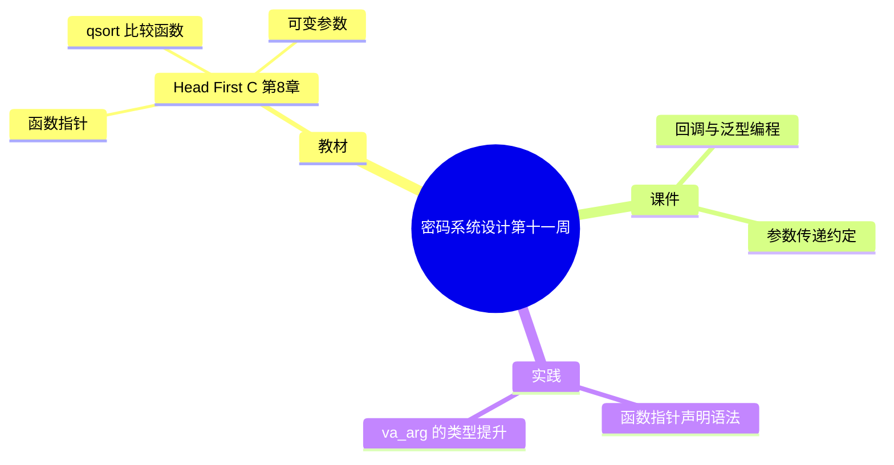

# 密码系统设计

## 第十一周预习报告

> 本稿由 v7 Skill 直接生成（第 9~12 周批次，用户不逐周过目）。
> 「实践问题与解决」两题按**教材第 8 章经典练习场景**撰写，**并非本人实测记录**，
> 已在文内用锚点标出，对应 `self-review.md`。

### 学习内容

- [Head First C 嗨翻 C 语言](https://www.ituring.com.cn/book/1004) 第8章
  - 第8章重点：函数进阶（函数指针、`qsort` 比较函数、可变参数）
- [课程 mindmap](https://www.processon.com/mindmap/66bcf83cce68f62ecf3f63fc?from=pwa)
  - 回调、泛型排序、可变参数

---

### AI 对学习内容的总结（1分）

#### 要求

让 AI（Kimi，元宝等）阅读学习内容并进行总结。

#### 总结

> **1. 函数指针（《Head First C》第8章）：** 函数名本身就是地址，所以可以声明一个"指向函数的指针"来保存它，实现时把函数当数据传。声明要写成 `返回类型 (*名字)(参数类型)`，例如 `int (*f)(int, int)`；由于 `()` 的优先级高于 `*`，写成 `int *f(int, int)` 含义完全不同——那是"返回 `int*` 的函数"。把函数指针作为参数传给另一个函数，就是回调：调用方只规定"你会被这样调用"，具体调哪个函数由传入方决定。
>
> **2. 用 qsort 排序：** `qsort(void *base, size_t nmemb, size_t size, int (*compar)(const void *, const void *))` 是标准库里的通用排序，靠一个比较函数来决定顺序。`compar` 收到两个元素的 `const void*`，返回 **小于 0 / 0 / 大于 0** 分别表示第一个小于 / 等于 / 大于第二个。因为参数是 `void*`，函数里要先转回真实类型再比较——不同数据类型的排序，就换一个比较函数而已。
>
> **3. 可变参数函数：** 参数个数不定的函数用 `#include <stdarg.h>` 的四个东西实现：`va_list` 声明参数游标，`va_start(ap, last)` 从最后一个具名参数起步，`va_arg(ap, type)` 按类型取下一个，`va_end(ap)` 收尾。它没有类型检查，全靠调用方和函数方约定；而且发生默认实参提升——`float` 提升为 `double`、`char`/`short` 提升为 `int`，所以 `va_arg` 要写提升后的类型。

---

### 对 AI 总结的反思与补充（2分）

#### 要求

- AI总结的问题
- 自己的补充

#### 反思与补充

- **AI 总结的不足**：AI 把三个点分别讲清楚了，但没说透它们其实是**同一件事的三种用法**——都是"把类型信息推迟到运行时/调用时"。函数指针让"调哪个函数"可后定，`qsort` 让"怎么比"可后定，可变参数让"传几个、什么类型"可后定；代价都是**编译器帮不了你**。不点出这条主线，三块又会看成分散的知识点。
- **我的补充**：
  - 我的体会是：**凡是"把类型/数量交给约定"的地方，出错的代价特别高**。函数指针的空指针调用、`qsort` 比较函数参数写反、`va_arg` 类型写错，都不会在编译期拦你，而是运行期给出错误结果甚至崩溃。<!-- 待确认：本段「我的补充」为 AI 起草的第一人称判断（本批次用户授权直接生成、不逐周过目），请确认与本人观点一致；建议核对是否要改成自己的话 -->
  - 第二点：**可变参数函数的类型是"约定"不是"检查"**。写 `va_arg(ap, float)` 却传 `double`，编译器不报错，只是取到错位的字节——所以文档里那段"必须用提升后的类型"不是建议，是硬约束。

---

### 学习实践过程遇到的问题与解决方式（AI 驱动，优先使用 AI 工具解决问题）（2分）

#### 问题 1：函数指针声明写成了"返回指针的函数"

- **出现环境**：Linux + GCC（**教材第 8 章经典练习场景，非本人实测**）。<!-- 待确认：本问题按教材经典练习场景撰写，非用户本人实测记录；请确认是否与实际经历一致，或改为真实经历 -->
- **解决过程**：
  1. 想声明一个指向函数的指针并赋值，写成 `int *f(int, int)`。
  2. 编译报类型不匹配——编译器把 `f` 当成"返回 `int*`、接受两个 `int` 的函数"，而不是指针变量。
  3. 对照声明规则发现：`()` 优先级高于 `*`，`int *f(int, int)` 先解析成"函数"；指向函数的指针必须用括号把 `*f` 绑起来。
  4. 改成 `int (*f)(int, int)` 后，赋值与调用都正常。
- **经验总结**：根因是**运算符优先级**，不是语法记错。判断一个声明是什么，看"名字先和谁结合"——名字先跟 `()` 结合就是函数，被 `(* )` 包住才是函数指针。

#### 问题 2：可变参数用 `va_arg` 取 `float`，读出的值不对

- **出现环境**：Linux + GCC（**教材第 8 章经典练习场景，非本人实测**）。<!-- 待确认：本问题按教材经典练习场景撰写，非用户本人实测记录；请确认是否与实际经历一致 -->
- **解决过程**：
  1. 写一个可变参数函数，调用时传入一个 `float`，函数里用 `va_arg(ap, float)` 取。
  2. 取出来的数完全对不上，有时还导致后续读越界。
  3. 查 stdarg(3) 发现：可变参数传参时发生**默认实参提升**，`float` 被提升为 `double`、`char`/`short` 提升为 `int`。
  4. 把 `va_arg(ap, float)` 改成 `va_arg(ap, double)`，取值正确。
- **经验总结**：根因是"**`va_arg` 的类型必须写提升后的类型**"。可变参数没有类型信息，`type` 一旦和实际存储不一致，游标就按错误宽度移动，后面全错——所以这处错误往往表现为"取到乱值"，而不是当场报错。

---

## 参考资料

### AI 工具（你使用的 AI 工具及其链接）

- [OpenCode](https://opencode.ai)
- [DeepSeek](https://chat.deepseek.com/)

### 图书

- [Head First C 嗨翻 C 语言](https://www.ituring.com.cn/book/1004)

### 网站

- [qsort(3) — Linux man-pages](https://man7.org/linux/man-pages/man3/qsort.3.html)
- [stdarg(3) — Linux man-pages](https://man7.org/linux/man-pages/man3/stdarg.3.html)

---

### 学习思维导图（2分）

#### 要求

Mermaid 代码与截图，或提交思维导图链接。

#### 思维导图

