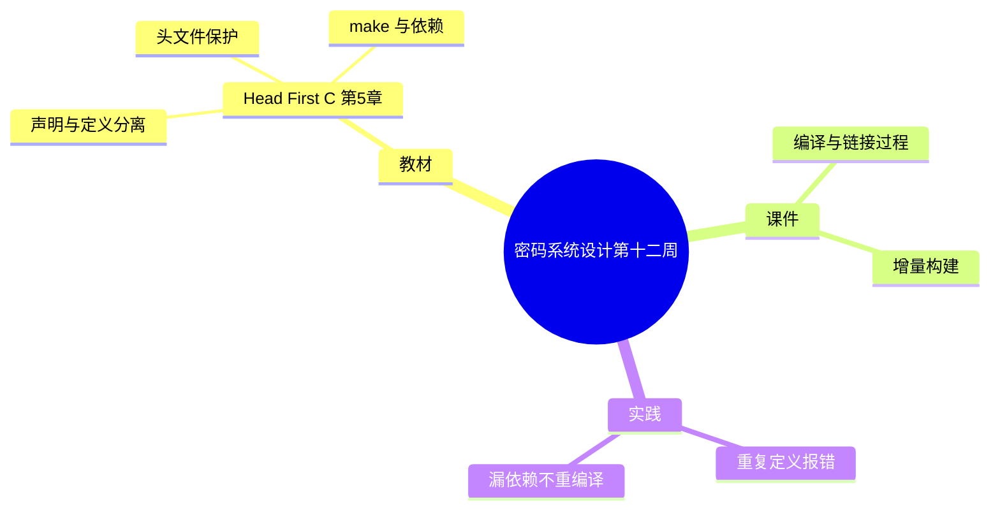

# 密码系统设计

## 第十二周预习报告

> 本稿由 v7 Skill 直接生成（第 9~12 周批次，用户不逐周过目）。
> 「实践问题与解决」两题按**教材第 5 章经典练习场景**撰写，**并非本人实测记录**，
> 已在文内用锚点标出，对应 `self-review.md`。

### 学习内容

- [Head First C 嗨翻 C 语言](https://www.ituring.com.cn/book/1004) 第5章
  - 第5章重点：使用多个源文件（声明与定义分离、头文件保护、`extern`/`static`、make 与依赖）
- [课程 mindmap](https://www.processon.com/mindmap/66bcf83cce68f62ecf3f63fc?from=pwa)
  - 编译与链接过程、增量构建

---

### AI 对学习内容的总结（1分）

#### 要求

让 AI（Kimi，元宝等）阅读学习内容并进行总结。

#### 总结

> **1. 声明与定义分离、编译与链接（《Head First C》第5章）：** 程序做大以后要拆成多个源文件。做法是把**声明**放进头文件（`.h`）、把**定义**放进源文件（`.c`）：头文件里写函数原型和 `extern` 变量声明，源文件里写真正的函数体和变量定义。`#include "x.h"` 在编译时把声明贴进来，让每个 `.c` 都能通过编译；`gcc -c` 先把每个 `.c` 各自编译成 `.o`，最后链接器把这些 `.o` 拼成可执行文件。`static` 用在文件作用域下，把函数或变量限制在本编译单元，外部看不到。
>
> **2. 头文件保护：** 同一个头文件可能被多条 `#include` 路径重复包含（尤其头文件互相引用时），会让同一份声明出现多次。用 `#ifndef X_H` / `#define X_H` / `#endif` 把头文件内容包起来：第一次包含时 `X_H` 未定义，内容生效并定义 `X_H`；再次包含时因已定义而被跳过。
>
> **3. make 与 Makefile：** 手工敲 `gcc -c` 一个个编译太啰嗦，make 把"目标文件依赖哪些文件、用什么命令生成"写成规则，形如 `目标: 依赖` 加一行命令。每次 `make` 时，make 比较目标与各依赖的时间戳：只要某个依赖比目标新，就重新执行命令；否则提示 `'xxx' is up to date`。这就是增量构建——但前提是**依赖写全**，漏掉的头文件不会被检查。

---

### 对 AI 总结的反思与补充（2分）

#### 要求

- AI总结的问题
- 自己的补充

#### 反思与补充

- **AI 总结的不足**：AI 把"多文件、头文件保护、make"分开讲了，但没说清它们**是一条链上的三个环节**：拆文件引出"声明放哪"（头文件）、头文件被反复包含引出"保护"、文件多到手工编译不动引出"make"。不点出这条因果链，三节看着像三块并列的知识，学完也不知道为什么需要它们。
- **我的补充**：
  - 我的体会是：**"重复定义"和"漏依赖"这两个坑，本质都是"声明与定义没摆对位置"**。前者是把定义写进了会被多处包含的头文件，后者是没把声明所在的头文件写进依赖——一个出错在链接期（`multiple definition`），一个出错得最安静（什么都不报，只是改了不生效）。<!-- 待确认：本段「我的补充」为 AI 起草的第一人称判断（本批次用户授权直接生成、不逐周过目），请确认与本人观点一致；建议核对是否要改成自己的话 -->
  - 第二点：**make 的依赖是"人造的"，它不会自己发现漏项**。所以最危险的不是 build 失败，而是 build 成功却用了旧目标文件——判断一个 Makefile 靠不靠谱，看它有没有把 `.h` 列进依赖（或有没有用自动依赖生成）。

---

### 学习实践过程遇到的问题与解决方式（AI 驱动，优先使用 AI 工具解决问题）（2分）

#### 问题 1：多个源文件一起链接时报重复定义

- **出现环境**：Linux + GCC（**教材第 5 章经典练习场景，非本人实测**）。<!-- 待确认：本问题按教材经典练习场景撰写，非用户本人实测记录；请确认是否与实际经历一致，或改为真实经历 -->
- **解决过程**：
  1. 把程序拆成两个 `.c` 文件，各自写了一句 `int counter;`，再一起链接。
  2. 链接器报错 `multiple definition of 'counter'`。
  3. 排查发现：`int counter;` 是**定义**（会分配存储），两个源文件各定义一份，链接时冲突；一个符号在整个程序里只允许定义一次。
  4. 改为：在头文件里写 `extern int counter;`（只是声明），只在一个 `.c` 里写 `int counter = 0;`（唯一定义），链接通过。
- **经验总结**：根因是**把"定义"当"声明"用**。头文件是给多个源文件共享"声明"的地方，放"定义"就会被包含几次、定义几份。记住一句分工：头文件放 `extern`/原型，`.c` 放真正的定义。

#### 问题 2：改了头文件，make 却说 up to date 不重编译

- **出现环境**：Linux + GCC + GNU make（**教材第 5 章经典练习场景，非本人实测**）。<!-- 待确认：本问题按教材经典练习场景撰写，非用户本人实测记录；请确认是否与实际经历一致 -->
- **解决过程**：
  1. Makefile 里写的是 `main.o: main.c`，没列头文件。
  2. 改了头文件里的一个常量后运行 `make`，输出 `make: 'main.o' is up to date`，程序行为还是旧的。
  3. 查 GNU make 手册确认：make 只按规则里列出的依赖比较时间戳，头文件不在依赖里就完全不管。
  4. 把规则补成 `main.o: main.c header.h`（或改用 `gcc -MMD -MP` 自动生成依赖文件），改头文件后能正确重编译。
- **经验总结**：根因是"**make 的依赖表是手写的，漏写不报错**"。这类 bug 最难查——它不失败、不告警，只是悄悄用了过期目标文件。所以凡是手工依赖，就得把所有会影响该目标输出的文件都列上，或者干脆交给 `-MMD -MP`。

---

## 参考资料

### AI 工具（你使用的 AI 工具及其链接）

- [OpenCode](https://opencode.ai)
- [DeepSeek](https://chat.deepseek.com/)

### 图书

- [Head First C 嗨翻 C 语言](https://www.ituring.com.cn/book/1004)

### 网站

- [GNU make 手册](https://www.gnu.org/software/make/manual/)
- [GCC Overall Options（-c 等）](https://gcc.gnu.org/onlinedocs/gcc/Overall-Options.html)

---

### 学习思维导图（2分）

#### 要求

Mermaid 代码与截图，或提交思维导图链接。

#### 思维导图

